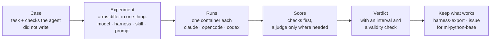

# Agentic Harness Lab

**Find out — with numbers, not vibes — whether your AI coding setup actually works,
and which model, harness or skill makes it work better.**

A *harness* is everything around a coding agent that is not the model: the rules
file, the skills, the agents, the hooks, the working loop. Teams write them by
feel. The lab measures them. You bring a task, a repository or a skill; it runs
coding agents (Claude Code, OpenCode, Codex) on it in isolated containers under the
configurations you choose, scores every run against checks the agent did not write,
and says how sure it is.

## What you get out of it

- **Try a vibecoded task properly.** Turn an idea into a test case with AI, run it,
  and when the agent stops short, *continue* the run instead of starting over.
- **Compare models systematically.** The same cases, several repetitions, two to four
  models — which one does the job, which tier of difficulty each does *reliably*,
  and whether the harness helps a small model more than a large one.
- **Audit your repository's harness.** Thirty seconds, no model:
  `make harness-check REPO=../your-project`. Or a full audit in the web app, with
  the gaps, the fixes and cases that would test them.
- **Measure your skill.** Import it, run the cases with and without it, see whether
  the agent even opened it.
- **Take home what works.** The whole governance, a few skills, or one skill,
  copied into your project — previewed first: `make harness-export`.
- **Improve the shared template.** Evidence from runs becomes an issue for
  [`ml-python-base`](https://github.com/xmartlabs/sdlc-ml-python-base), and the next
  release is measured before it is trusted.

## Start

```bash
git clone https://github.com/xmartlabs/sdlc-ml-python-harness-lab.git
cd sdlc-ml-python-harness-lab
cp .env.example .env      # add ONE credential: a Claude token or your AI gateway
make app-up               # http://localhost:5173
```

The credential, the first run and troubleshooting: **[onboarding](docs/onboarding.md)**
(about 15 minutes). Then **[docs/README.md](docs/README.md)** — six one-page journeys:

| You want to… | Read |
|---|---|
| Turn an idea, a SWE-bench issue or a repo task into a **test case** | [Create a case](docs/journey-create-a-case.md) |
| **Run it** with different models, harnesses and skills — repeat it, continue it | [Run and compare](docs/journey-run-and-compare.md) |
| Know **what a result says**, and when to believe it | [Read the results](docs/journey-read-results.md) |
| **Audit your repository** or **measure your skill** | [Bring your repo or skill](docs/journey-bring-your-repo-or-skill.md) |
| **Take the harness, or one skill,** into your project | [Take it home](docs/journey-take-it-home.md) |
| Turn what you learned into a **better template** | [Improve the template](docs/journey-improve-the-template.md) |

Showing it to a team: the [demo guide](docs/demo-guide.md) is a 20-minute script.

## How it works



- **The lab refuses a design it cannot answer** — two factors changed at once, an
  arm that would be identical to its control, a case whose check cannot fail.
- **A result says how sure it is.** Every comparison carries a 95% interval, a
  strength word (*exploratory*, *judgement*, *validation*) and a validity banner
  that flags when the runs measured the lab instead of the agent.
- **Failures are told apart.** A run that died on the gateway, a missing package or
  an old CLI is labelled as the lab's and is not counted against the model.

## What it is not

- Not a leaderboard of people. It measures configurations, never developers.
- Not a replacement for your CI. It measures how well an *agent* does your tasks.
- Not safe for untrusted code by default: runs execute model output with the
  repository mounted. Read [SECURITY.md](SECURITY.md) first.
  [Known limitations](docs/known-limitations.md) lists what it does not do yet.

## The harness under test

By default, the harness the lab measures is **its own** — this repository's
governance, which is the `ml-python-base` template. That closes the loop: the
harness you measure is the harness you improve. A run can instead target **your**
repository, with its own harness (`native`), none (`bare`) or the lab's projected
into it (`injected`); see [bring your repo or skill](docs/journey-bring-your-repo-or-skill.md).

## Working on the lab itself

```bash
make install        # Python 3.11 + dependencies (uv)
make ci             # the read-only gate: lint, types, tests, skill sync, frontend
```

The lab is built on its own template: its working loop (Ground → Plan → Delegate →
Verify → Compound), skills and governance are in [`.github/`](.github/) and
[agentic workflow](docs/agentic-workflow.md). Decisions are recorded as
[ADRs](docs/adr/README.md). `make help` lists every command.

| Task | Command or page |
|---|---|
| Format and fix | `make format && make fix` |
| Add a dependency | `make add PKG=<name>` |
| Refresh the skill views after editing `.github/skills/` | `make sync-skills` |
| Which template version the lab runs; adopt a newer one | `make harness-status`, [lab sync workflow](docs/harness-lifecycle/lab-sync-workflow.md) |
| Leave the lab running on a server | `make set-password && make app-up-prod` ([onboarding](docs/onboarding.md#protect-the-ui-if-the-lab-is-not-on-your-laptop)) |
| Develop with a dev container | VS Code → *Reopen in Container* |

See [CONTRIBUTING.md](CONTRIBUTING.md). CI fails a pull request that changes `src/`
or `tests/` without changing `docs/`.

## License

[Apache License 2.0](LICENSE). Copyright 2026 Marcos Soto. Vendored skills under
`.github/skills-external/` keep their own licenses — see [NOTICE](NOTICE).
[Code of conduct](CODE_OF_CONDUCT.md) · [Security](SECURITY.md)
