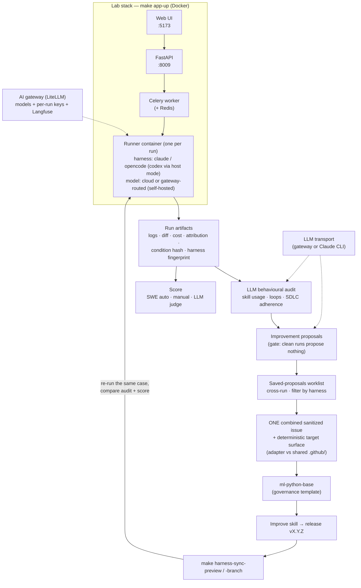

# Agentic Harness Lab

A local web app and toolkit for **benchmarking agentic coding harnesses** (Claude Code,
OpenCode, Codex, Antigravity, …) and models on real coding tasks — and feeding what you
learn back into the shared governance template (`ml-python-base`) as concrete skill
improvements.

Run agents on custom cases and SWE-bench / SWE-bench Pro issues in isolated Docker
containers, capture per-run provenance (condition hash, harness fingerprint, cost,
skills consulted), audit behaviour with an LLM, and compare harness/model conditions —
all from the web UI.

> **First time on this machine?** Follow the step-by-step
> **[Onboarding guide](docs/onboarding.md)** — credentials (AI gateway / Claude
> account), `.env`, first run, troubleshooting.
>
> **Already set up?** `make app-up` → `http://localhost:5173`. Screens explained in
> the **[Web UI guide](docs/guide-web-ui.md)**.
>
> **Improving the template from what you observe?** Follow the
> **[harness improvement loop](docs/harness-lifecycle/README.md)** — run a case → audit
> → generate a sanitized issue for `ml-python-base` → improve the skill → re-measure.

## 🚀 What it does

- **Benchmark lanes** — custom cases, SWE-bench, and SWE-bench Pro, one Docker
  container per run (Celery + Redis), with cancel/retry and orphan reconciliation.
- **Multiple harnesses** — Claude Code and OpenCode in the runner container, Codex via
  host mode, selectable per run; Antigravity through a manual flow
  (`make bench-antigravity`).
- **Rich provenance** — condition hash, harness fingerprint, prompt/case hashes, cost,
  tokens, steps, diff, and skills consulted, captured per run.
- **Behavioural audit** — an LLM reads a run's artifacts and reports skill usage, loops,
  and SDLC adherence.
- **A/B comparison** — control vs harness-wrapped arms to isolate the harness's effect.
- **Experiments over runs** — state the question first, declare the arms, and the lab
  *refuses* a design its mode cannot answer. Results are read as a **case matrix**
  (fixed / broken / unchanged), not as one composite number
  ([ADR-0033](docs/adr/0033-experiment-above-run.md)).
- **Three ways in** — evaluate a harness change, test one across repositories, or
  audit a repository you have never seen
  ([ADR-0028](docs/adr/0028-evaluation-modes.md)). The UI starts from the question,
  not from the schema.
- **Batch runs** — queue a whole cross-product (cases × harnesses × prompts × models ×
  repetitions) from one form, validated all-or-nothing (see
  [ADR-0023](docs/adr/0023-batch-run-execution.md)).
- **Improvement loop** — turn audit findings into sanitized issues for `ml-python-base`
  and re-measure (see the [harness improvement loop](docs/harness-lifecycle/README.md)).
- Built on **`uv` + `ruff` + `pytest`** with a read-only CI gate (`make ci`).

## ⚠️ Scope: which harness is under test

Read this before cloning, so it is not a surprise afterwards.

**By default, the harness under test is the repository the lab runs from.**
`repo_root` defaults to the working directory, and the governance surface a run sees
— `.github/skills/`, the generated `CLAUDE.md` / `AGENTS.md` / `OPENCODE.md`, the
agents, the hooks — is this repo's own, which is the
[`ml-python-base`](https://github.com/xmartlabs/sdlc-ml-python-base) template. That
is deliberate: it closes the improvement loop, because the harness you measure is the
harness you then improve and re-measure.

**A run can also target another repository.** Register it under **Evidence →
Repositories**, clone it into `data/checkouts/<target_id>` with the command the UI
shows, and the lab pins the commit per run
([ADR-0029](docs/adr/0029-target-repositories-pinned-per-run.md),
[ADR-0042](docs/adr/0042-the-lab-reads-a-repository-through-the-engineers-own-checkout.md)).
The governance a run sees is then a per-run condition, `harness_source`
([ADR-0031](docs/adr/0031-harness-source-is-a-run-condition.md)): `lab_root` (this
repo's), `native` (the target's own) or `injected` (this repo's, projected into the
target). Guide: [Target repositories](docs/guide-target-repositories.md).

What that means in practice:

- The **Harness** selector picks *which CLI drives the run* (Claude Code, OpenCode,
  Codex). Which governance the CLI reads is `harness_source`, not the CLI.
- A harness sourced from a *third* repository (target A + harness B) is still out of
  scope — see [Known limitations](docs/known-limitations.md#harness-coupling).
- A run with a **skill ablation** rewrites the native skill views in the working tree
  and restores them afterwards. Do not run benchmarks against a tree with uncommitted
  governance changes.

Before running anything, read [SECURITY.md](SECURITY.md): runs execute untrusted model
output with the repository mounted read-write and your `.env` in the container
environment.

## 🗺️ How it fits together



The loop closes when a re-run under the new governance version shows the symptom
gone — the lab measures whether the template improvement actually worked.

## 🔄 The improvement cycle

The lab runs its cases against a **specific version of the `ml-python-base`
governance** — the skills, agents, and rules the agent is given. That version is what
you improve. The full loop, tied to it:

1. **Run & observe.** Run a case in the UI (harness `claude`, a governance-loaded
   prompt variant like `sdlc_full` for Tetris or `swe_harness` for SWE-bench), let it
   finish, and open the run. The **Attribution** panel shows which skills were
   consulted; the **Run audit** button writes a behavioural diagnosis. `make harness-status` shows which template version
   the lab is currently running.
2. **Generate the issue.** On the run, open the **Sanitised issue** panel. It shows
   a ready-to-paste, sanitized markdown issue (no private data). **Copy the whole block
   and open a new issue in
   [`ml-python-base`](https://github.com/xmartlabs/sdlc-ml-python-base)** — the first
   line is the title, the rest is the body.
3. **Improve & release.** In `ml-python-base`, improve the skill (your own agent/LLM),
   merge, and **cut a new release** (`vX.Y.Z`). Close the issue.
4. **Update the lab & validate.** Point the lab at the new version and **re-run the
   same case** to see whether it actually improved:

   ```bash
   make template-remote-setup             # first time only — see "Template governance"
   make harness-status                    # current version vs latest (vX.Y.Z)
   make harness-sync-preview REF=vX.Y.Z   # read-only diff of the new governance
   make harness-sync-clean  REF=vX.Y.Z    # only if a candidate for that REF exists
   make harness-sync-branch REF=vX.Y.Z    # prepare it in an isolated candidate worktree
   #   light alternative: make template-sync REF=vX.Y.Z
   ```

   `harness-sync-branch` refuses to overwrite an existing candidate, so **run
   `harness-sync-clean` first when re-preparing the same REF** — the error names the
   command. It also refuses a dirty `main`, and `git status --porcelain` counts
   untracked files, so `git reset --hard` alone will not satisfy it: `git stash -u`
   or remove the stray files.

   The candidate is left **uncommitted** in its worktree. Review it, run the gate
   there, and only then commit and merge it yourself:

   ```bash
   git -C .worktrees/harness-candidate-vX.Y.Z --no-pager diff HEAD
   (cd .worktrees/harness-candidate-vX.Y.Z && make check && make check-sync)
   ```

   To discard instead, `make harness-sync-clean REF=vX.Y.Z` — it force-removes the
   worktree, so anything uncommitted in there is gone.

   Then re-run the case (same harness/model/prompt) and compare its **Attribution** +
   **Audit** against the earlier run: did the symptom improve? Did the success
   criterion hold? If yes, the new version is validated; if not, iterate again.

   For a release rather than a single symptom, run the **regression suite as an
   experiment** — *Evaluate → New evaluation*, tick **Use the regression suite**, with
   the previous version as control and the new one as treatment. The suite supplies
   the canonical cases and their repetition counts, and the answer arrives as
   *fixed / broken / unchanged*
   ([ADR-0037](docs/adr/0037-regression-suite-produces-experiments.md)).

Deliberately light and human-driven — full playbook in
**[docs/harness-lifecycle/improvement-methodology.md](docs/harness-lifecycle/improvement-methodology.md)**.
For the rigorous, fully-traceable form (immutable releases + the canonical regression
suite with hard gates), see the
[harness lifecycle docs](docs/harness-lifecycle/README.md).

## 📚 Documentation map

| If you are… | Start here |
|---|---|
| **Setting up for the first time** | [Onboarding guide](docs/onboarding.md) — prerequisites, credential paths (gateway / Claude), `.env`, first run, troubleshooting |
| **Operating the lab day-to-day** | [Web UI guide](docs/guide-web-ui.md) — every screen, plus what every run metric means and which of them are a model's opinion; [Continuing a run](docs/guide-run-continuation.md) — push a stopped run further with a new prompt; [Improvement cycle](docs/improvement-cycle.md) — audit → proposals → GitHub issues; [Langfuse observability](docs/guide-langfuse-observability.md) — read a run turn by turn |
| **Trialling a new skill** | [Skill validation guide](docs/guide-skill-validation.md) — import from a URL, A/B it, promote it; [Skills management](docs/skills-management.md) — the governed catalog and the sync engine |
| **Diagnosing a lab that misbehaves** | The **Health** screen ([guide](docs/guide-web-ui.md#health)) — reachability, drift and the five repairs ([ADR-0018](docs/adr/0018-health-and-drift-panel.md)); [Onboarding troubleshooting](docs/onboarding.md#5-smoke-test--your-first-run) |
| **Improving the template** | [Improvement methodology](docs/harness-lifecycle/improvement-methodology.md) — when to trust a proposal; [Lab sync workflow](docs/harness-lifecycle/lab-sync-workflow.md) — adopt & validate a release; [Harness lifecycle](docs/harness-lifecycle/README.md) — the rigorous form |
| **Auditing another team's repository** | [Auditing someone else's repository](docs/guide-web-ui.md#auditing-someone-elses-repository--worked-example) — the end-to-end walkthrough; [Target repositories](docs/guide-target-repositories.md) — the reference ([ADR-0029](docs/adr/0029-target-repositories-pinned-per-run.md)); [What the lab can run](docs/guide-runner-capabilities.md) — why a repository's language does not decide whether its cases run ([ADR-0056](docs/adr/0056-cases-are-matched-against-runner-capabilities.md)) |
| **Designing a comparison** | [Web UI guide](docs/guide-web-ui.md#new-evaluation--the-wizard-for-modes-a-and-b) — the wizard, and why it will not let you build an unanswerable design; [Lab v2 roadmap](docs/roadmap-lab-v2.md) — experiments, modes and what each licenses ([ADR-0028](docs/adr/0028-evaluation-modes.md), [ADR-0033](docs/adr/0033-experiment-above-run.md)); [score registry](docs/adr/0034-score-registry.md) — facts, observations and judgements kept apart; [ADR-0036](docs/adr/0036-audit-judges-a-run-against-its-own-governance.md) — why a `native` control is never judged against the lab's rules |
| **Comparing harnesses / models** | [Harness adapters](docs/harness-adapters.md) — claude/opencode/codex design; [claude & codex runbook](docs/runbook-claude-codex.md); [First-run benchmark runbook](docs/runbook-first-run.md) (legacy CLI lane) |
| **Using SWE-bench lanes** | [SWE-bench cases](docs/design-swe-bench-cases.md); [SWE-bench Pro lane](docs/design-swe-bench-pro-lane.md); [Curated set](docs/swebench-curated-set.md) |
| **Running self-hosted models** | [Local model runtime config](docs/local-model-runtime-config.md); [Task sizing](docs/task-sizing.md); [OpenCode workflow](docs/opencode-workflow.md) |
| **Developing the lab itself** | [Agentic workflow](docs/agentic-workflow.md) — the working loop; [ADRs](docs/adr/README.md) — why things are the way they are; [Skills management](docs/skills-management.md) |
| **Where the lab is going** | [Lab v2 roadmap](docs/roadmap-lab-v2.md) — experiments over runs, target repositories, the four-level evaluation model; [Local web app roadmap](docs/roadmap-local-webapp.md) — how v1 was built |
| **Adding trajectory scores** | [Onboarding § DeepEval](docs/onboarding.md#6-trajectory-scores-deepeval--on-by-default-in-docker) — on by default in Docker, the judge model it uses, and what happens without it |
| **Knowing what it does *not* do** | [Known limitations](docs/known-limitations.md) — accepted debt, stated up front; [SECURITY.md](SECURITY.md) — what a run container can actually reach |

## 📋 Prerequisites

- **Docker Desktop** — required; the web app and every agent run in containers.
- **Make** and **git**.
- [uv](https://github.com/astral-sh/uv) — Python 3.11+ package manager (only needed to
  develop the lab itself; the app stack runs in Docker).
- One credential: an AI-gateway token (Path A) or a Claude account (Path B) — see
  **Setup** below.

### Install uv

```bash
# macOS/Linux
curl -LsSf https://astral.sh/uv/install.sh | sh

# Or with pip
pip install uv
```

## 🛠️ Quick Start

> Full first-time walkthrough (credential paths, gateway setup, smoke test,
> troubleshooting): **[docs/onboarding.md](docs/onboarding.md)**.

### 1. Setup (first time, per machine)

```bash
git clone https://github.com/xmartlabs/sdlc-ml-python-harness-lab.git
cd sdlc-ml-python-harness-lab
cp .env.example .env
```

Then edit `.env` — there are **two credential paths**, and **either one alone is
enough to run the lab end to end**:

- **Path A — AI gateway (LiteLLM), recommended:** `GATEWAY_BASE_URL` +
  `GATEWAY_TOKEN` + `LITELLM_MASTER_KEY`. Powers the `opencode` harness
  (gateway-routed models, incl. self-hosted), every in-process LLM call
  (**audit**, **improvement synthesis**, SWE-Pro auto-scoring, DeepEval's
  trajectory judge), and Langfuse attribution. The UI reads the gateway's model
  list live (**Settings → Refresh from gateway**); `make sync-gateway-models` is
  only for promoting a model into the tracked `opencode.json`.
- **Path B — Claude with your own account:** `CLAUDE_CODE_OAUTH_TOKEN` (from
  `claude setup-token`) or `ANTHROPIC_API_KEY`. Authenticates the `claude`
  harness inside the runner container **and** every in-process LLM call above,
  by driving the Claude Code CLI headless — so a subscription alone covers the
  whole benchmark → audit → improve loop
  ([ADR-0043](docs/adr/0043-one-llm-transport-gateway-first-claude-cli-second.md)).
  The gateway keeps priority whenever both are set.

Add the gateway when you want to compare *models* across providers or need
per-run cost attribution.

Other tools (codex via host mode, direct LM Studio/Ollama, antigravity): see
[Path C in the onboarding guide](docs/onboarding.md#path-c--other-harnesses-and-backends).

Finally, point the lab at the template (once) so you can pull governance versions:

```bash
make template-remote-setup    # see "Template governance" below
```

### 2. Run the lab (web app)

```bash
make app-up          # builds the runner image + starts api/worker/redis/frontend
```

Open **http://localhost:5173**. New here? Read the
**[Web UI guide](docs/guide-web-ui.md)**. `claude` and `opencode` run inside the
runner container using the auth from `.env`; `codex` needs host mode
(`make app-host`) and `antigravity` is a manual flow (`make bench-antigravity`);
see [docs/harness-adapters.md](docs/harness-adapters.md).

**Network exposure.** The API binds to `127.0.0.1:8009` by default, but the dev
frontend (Vite) listens on `0.0.0.0:5173` and proxies `/api`, so with `make app-up`
anyone on your LAN who reaches `:5173` can drive the lab until you run
`make set-password`. Leaving the lab running on a server instead of a laptop?
Protect it and switch to the always-on profile — one origin on `:8080`, bound to
loopback unless `HARNESS_LAB_BIND_ADDR` says otherwise, restarts with the host,
rotated logs ([ADR-0019](docs/adr/0019-always-on-local-deployment.md)):

```bash
make set-password    # single-user password; set it before exposing anything
make app-up-prod     # nginx :8080 on 127.0.0.1; API on loopback only
```

| Mode | Web UI | API | Command |
|---|---|---|---|
| Dev (laptop) | `:5173` (Vite, all interfaces) | `127.0.0.1:8009` | `make app-up` |
| Always-on (server) | `:8080` (nginx, `HARNESS_LAB_BIND_ADDR`, default loopback) | loopback only | `make app-up-prod` |

### Develop the lab (optional — only to work on the lab itself)

```bash
make install                 # pin Python, create .venv, sync from uv.lock
source .venv/bin/activate
make setup-hooks             # pre-commit hooks (optional, recommended)
make ci                      # read-only quality gate (ruff, mypy, bandit, pytest)
```

### 🐳 Dev Containers (Recommended)

This project is configured to run inside a **Dev Container**. This guarantees that you are working in the exact same environment as production (Linux), regardless of your local OS (macOS, Windows).

### How to use

1. Install **Docker Desktop**.
2. Install the **Dev Containers** extension in VS Code.
3. Open the project in VS Code.
4. Click on the pop-up **"Reopen in Container"** (or run the command from the Palette).

### Benefits

- **Zero Setup**: The container installs Python, `uv`, and all dependencies automatically.
- **Production Parity**: Develop on Linux, deploy on Linux.
- **Jupyter Integration**: Notebooks run seamlessly inside the container, using the container's kernel.


## 📦 Managing Dependencies

We use `uv` to manage dependencies in `pyproject.toml` and lock them in `uv.lock`.

### Add a new library

Instead of editing files manually, use the helper command:

```bash
# Add a package (e.g., tensorflow)
make add PKG=tensorflow

# Add a development dependency
make add PKG="pytest --dev"
```

This will:
1. Add the package to `pyproject.toml`
2. Update `uv.lock`
3. Install the package in your environment

### Remove a library

To remove a package you no longer need:

```bash
make remove PKG=tensorflow
```

### Generate requirements.txt

If you need a `requirements.txt` for legacy systems or deployment:

```bash
make generate-requirements
```

## 🎯 Code Quality

The project provides four main levels of code quality checks:

1. **`make fix` (Recommended)**: The "do it all" command. It auto-formats code, sorts imports, removes unused imports, fixes linting issues, and cleans Jupyter notebooks. Run this frequently!
2. **`make fix-force`**: Same as `fix`, but applies "unsafe" fixes. Use with caution (e.g., it might remove imports used only in `try/except` blocks).
3. **`make lint`**: Runs strict static analysis and security checks (Bandit). It does not modify files. Use this to verify your code before pushing.
4. **`make format`**: A lighter version of `fix`. Only formats code and sorts imports.

```bash
# 1. Clean everything (Safe mode)
make fix

# 2. Clean everything (Aggressive mode - check changes after!)
make fix-force

# 3. Verify quality and security (Read-only check)
make lint

# 4. Read-only gate: check + check-sync + check-frontend
make ci
```

## 📁 Project Structure

```
.
├── src/harness_lab_app/    # Backend: FastAPI API, Celery tasks, services, harness_lifecycle
├── frontend/               # React/TypeScript web UI
├── benchmarks/             # Cases + the canonical regression suite (harness-regression-v1)
├── scripts/                # bench_run, bench_audit, harness_lifecycle CLI, …
├── .github/                # Governed skills, agents, and governance docs (from the template)
├── data/runs/              # Per-run artifacts (git-ignored)
├── data/harness-proposals/ # Reviewed HEP proposals (tracked)
├── docs/                   # Guides, ADRs, and the harness lifecycle docs
├── Makefile                # Commands
├── pyproject.toml          # Config & dependencies
├── uv.lock                 # Exact versions lockfile (DO NOT EDIT MANUALLY)
└── .harness-version.yaml   # The adopted ml-python-base governance version (once set);
                            # .template-version is the legacy mirror written by make template-sync
```

## 🧭 AI Rules Structure (Cross-Tool)

The lab's governance — inherited from `ml-python-base` — uses a consistent four-level
strategy that works across Claude Code, OpenCode, Codex, Antigravity, and Copilot. It
is exactly the harness the lab benchmarks and improves.

### Level 1 — Governance

- `.github/architecture.md`
- `.github/standards.md`
- `.github/domain-boundaries.md`

### Level 2 — Operational Skills

Governed skills live in `.github/skills/` (internal, the source of truth) and
`.github/skills-external/` (vendored). They are projected into each tool's native
layout (`.claude/skills/`, `.opencode/skills/`, `.agents/skills/`) by the sync engine:

```bash
make sync-skills             # refresh native skill/agent views + skills-lock.json
make check-sync              # fail if any generated skill artifact is stale
```

See `.github/skills/README.md` for the current catalog. Improvements to these skills
flow back to the template via the
[harness improvement loop](docs/harness-lifecycle/README.md).

### Level 3 — Automation

- `.github/automation.md`
- CI and local checks through `make lint`, `make test`, and `make ci`
- On PRs, if `src/` or `tests/` changes, at least one file in `docs/` must be updated
- Test flow enforces `make format` and `make fix` before running tests

### Level 4 — Orchestration

- `.github/orchestration.md`
- Plan-first requirement
- Step-by-step execution
- Mandatory diff review
- Validation against automation
- No direct large generation without skill invocation

Adapters:

- Claude Code entrypoint: `CLAUDE.md`
- Claude Code native skills: `.claude/skills/` generated from `.github/skills/` and `.github/skills-external/`
- Copilot entrypoint: `.github/copilot-instructions.md`
- Antigravity workspace rules: `.agents/rules/`
- Antigravity native skills: `.agents/skills/` generated from `.github/skills/` and `.github/skills-external/`

Documentation template:

- `docs/implementation-template.md` (use it when implementing and testing new changes)

Self-hosted / local-model mode (`local_model_32k`):

- To develop with small self-hosted models (Qwen 3.x / 3.6, 27B-35B @ 32k), the recommended
  path is **OpenCode routed through your ai-gateway** (`make opencode`): plan with a strong
  cloud model, build local at $0, all visible in Langfuse. Start with the **"Priority order"**
  in [docs/local-model-runtime-config.md](docs/local-model-runtime-config.md) — the mechanical
  layer (gateway output cap, repetition penalty, served context) that makes a 32k model
  usable. Short operating rules: `LOCAL_AGENT.md`. Sizing heuristics:
  [docs/task-sizing.md](docs/task-sizing.md).

## 🔁 Agentic Working Loop

Beyond the cross-tool rules above, this template ships an opinionated **working loop**
for AI-assisted development — optimized for Claude Code — so the high-quality path is
the path of least resistance:

**Ground → Plan → Delegate → Verify → Compound.**

| Piece | Where | Purpose |
|-------|-------|---------|
| Operating playbook | `CLAUDE.md` → *Operating playbook* | The loop as standing instructions for the agent. |
| Slash commands | `.claude/commands/` | `/plan`, `/orchestrate`, `/verify`, `/adr`, `/retro`. |
| Loop skills | `.github/skills/` | `systematic_debugging`, `verify_changes`, `retrospective` (+ existing planning/review skills). |
| Hooks (nudge) | `.claude/settings.json`, `.claude/hooks/` | Inject the loop at session start; remind to verify/compound when code changed. Non-blocking. |
| Memory | `memory/` | Persistent working memory (`context`, `learnings`, `patterns`) across sessions. |
| Decisions | `docs/adr/` | Architecture Decision Records — the durable "why". |
| MCP servers | `.mcp.json` | Optional extra tools (library docs via context7, git). Opt-in; require the tool to be installed. |

Full guide: [docs/agentic-workflow.md](docs/agentic-workflow.md). How this maps to
assessments of AI-assisted coding skill (and what a template can/can't influence):
[docs/agentic-scoring.md](docs/agentic-scoring.md).

## 🔧 Available Commands

| Command | Description |
|---------|-------------|
| `make install` | Setup environment, install python version and sync dependencies |
| `make add PKG=x` | Add a new dependency to the project |
| `make remove PKG=x` | Remove a dependency from the project |
| `make setup-hooks` | Install pre-commit hooks for git |
| `make format` | Format code with Ruff |
| `make lint` | Run code quality checks |
| `make fix` | Auto-fix linting issues |
| `make test` | Run tests with coverage |
| `make check` | Read-only quality gate: ruff format --check, ruff check, bandit, mypy, pytest |
| `make ci` | Read-only CI gate: `check` + `check-sync` + `check-frontend` |
| `make setup-claude-skills` | Generate `.claude/skills` native symlinks from governed skills |
| `make setup-antigravity-skills` | Generate `.agents/skills` native Antigravity mirror from governed skills |
| `make sync-skills` | Sync external skills, refresh `skills-lock.json`, and refresh Claude and Antigravity native skill layouts |
| `make purge-external-skills` | Remove all external skills and refresh Claude and Antigravity native skill layouts |
| `make app-up` | Start the web app in Docker (api + worker + redis + frontend) |
| `make harness-status` | Installed template version vs latest release + drift |
| `make harness-sync-preview REF=vX.Y.Z` | Read-only diff of a candidate template release |
| `make harness-sync-branch REF=vX.Y.Z` | Prepare a candidate in an isolated worktree |
| `make harness-sync-clean REF=vX.Y.Z` | Discard a candidate worktree and its branch (required before re-preparing the same REF) |
| `make harness-proposal RUN=<id>` | Draft a sanitized improvement issue for the template |
| `make template-remote-setup` | Add or update the `template` upstream remote |
| `make template-sync REF=vX.Y.Z` | Legacy selective governance sync from a tag |
| `make generate-requirements` | Export `uv.lock` to `requirements.txt` |
| `make clean` | Remove cache and generated files |
| `make help` | Show all available commands |

## Template governance

The lab's governance layer — skills, agents, governance docs, and adapter templates —
comes from the [`ml-python-base`](https://github.com/xmartlabs/sdlc-ml-python-base)
template. The lab **consumes** it as an immutable release; it does not publish it.

### First-time setup (once)

Point the lab at the template repository — this adds a git remote named `template`:

```bash
make template-remote-setup
# adds the `template` remote → git@github.com:xmartlabs/sdlc-ml-python-base.git
```

Using a fork or HTTPS? Override the URL:

```bash
make template-remote-setup TEMPLATE_REPO=https://github.com/<you>/ml-python-base.git
```

### Everyday use

```bash
make harness-status                   # installed version vs latest release + drift
make harness-sync-preview REF=vX.Y.Z  # read-only diff of a candidate release
make harness-sync-branch  REF=vX.Y.Z  # prepare the candidate in an isolated worktree
make harness-sync-clean   REF=vX.Y.Z  # discard it — also required before re-preparing
```

Preconditions worth knowing before the first run: `harness-sync-branch` needs a clean
`main` (untracked files count — `git stash -u`) and no existing candidate for that REF.
The candidate it prepares is uncommitted; reviewing, committing, and merging it is
still a manual step, so `make harness-status` keeps reporting the old version until
you do.

Full flow (installed state, isolated candidate worktree, adoption, compatibility): see
**[docs/harness-lifecycle/lab-sync-workflow.md](docs/harness-lifecycle/lab-sync-workflow.md)**.
The lighter legacy selective sync — `make template-sync REF=vX.Y.Z` (governance layer
only; never touches `src/`, `Makefile`, `data/`, or the sync engine) — also works, and
records the adopted version in `.template-version` so `make harness-status` can show it.

To feed improvements *back* to the template from what the lab observes, follow the
**[harness improvement loop](docs/harness-lifecycle/README.md)**.

## 🐳 Docker

The web app runs entirely in Docker via `make app-up` (api + worker + redis + frontend,
plus a per-run runner container). Agents — including `claude` — execute inside the
runner image with auth supplied from `.env` (`CLAUDE_CODE_OAUTH_TOKEN` / `ANTHROPIC_API_KEY`).

```bash
make app-up          # build the runner image + start the full stack
make app-down        # stop the stack (required before make app-reset-db)
```

## 📝 Configuration

- **Dependencies**: `pyproject.toml` - `[project.dependencies]`
- **Ruff**: `pyproject.toml` - `[tool.ruff]`
- **Pytest**: `pyproject.toml` - `[tool.pytest.ini_options]`
- **Editor**: `.editorconfig`

## 🤝 Contributing

See [CONTRIBUTING.md](CONTRIBUTING.md) for setup, the quality gate, which files are
generated (never edit those by hand), and the conventions this repo enforces.

The short version: branch, change, `make format && make fix && make ci`, open a PR.
CI fails a PR that touches `src/` or `tests/` without touching `docs/`.

Security issues go through [SECURITY.md](SECURITY.md), not the issue tracker.

## 📄 License

[Apache License 2.0](LICENSE). Copyright 2026 Marcos Soto.

Vendored third-party components — the external agent skills under
`.github/skills-external/` and their generated mirrors — keep their own
upstream licenses. See [NOTICE](NOTICE) before redistributing.

Contributing: [CONTRIBUTING.md](CONTRIBUTING.md) ·
[CODE_OF_CONDUCT.md](CODE_OF_CONDUCT.md) · [SECURITY.md](SECURITY.md)
