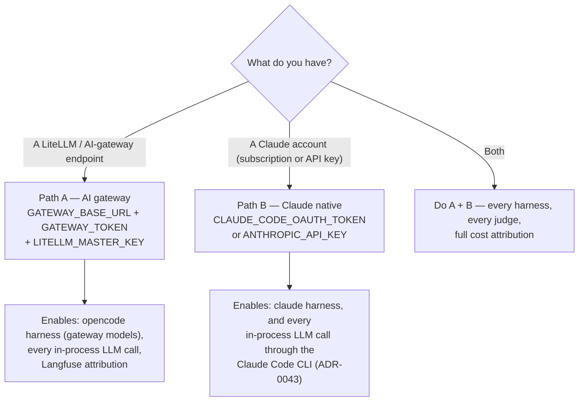

# Onboarding — run the lab for the first time

Step-by-step setup for a developer cloning the lab on a **new machine**. At the end
you will have the web app running, one benchmark run executed, and the improvement
loop within reach.

Already set up? Start at [docs/README.md](README.md) — six one-page journeys.

---

## 1. Prerequisites

| Tool | Why | Check |
|---|---|---|
| **Docker Desktop** | The web app and every agent run in containers | `docker info` |
| **make** + **git** | All workflows are Makefile-driven | `make --version` |
| [uv](https://github.com/astral-sh/uv) | The shell tools — `make harness-check`, `make harness-export`, `make demo-check` — and developing the lab | `uv --version` |
| **Node 20+** *(optional)* | Only for host-mode frontend development | `node --version` |

```bash
git clone https://github.com/xmartlabs/sdlc-ml-python-harness-lab.git
cd sdlc-ml-python-harness-lab
cp .env.example .env
```

Everything below is about filling in `.env` (it is gitignored — keys never get
committed) and starting the stack.

## 2. Choose your credential path

The lab has **two independent credential surfaces**. Either one on its own is
enough to use the lab end to end; together they let you compare models across
providers.



Everything the lab does with an LLM is one of two things: a **harness run** (an
agent working in a container) or an **in-process call** (an audit, a judge, a
summary). Harness lanes need their own credential. In-process calls go over one
shared transport that prefers the gateway and falls back to the Claude CLI, so
they work under either path:

| Feature | Path A alone (gateway) | Path B alone (Claude) |
|---|---|---|
| `opencode` harness runs (gateway-routed models, incl. self-hosted) | ✅ | — |
| `claude` harness runs | — | ✅ |
| Behavioural **audit** ("Run audit" button) | ✅ | ✅ |
| **Improvement proposals** / sanitized issue synthesis | ✅ | ✅ |
| SWE-bench Pro **auto-scoring** (LLM judge) | ✅ | ✅ |
| DeepEval `task_completion` / `step_efficiency` | ✅ | ✅ |
| Case summary polish on import | ✅ | ✅ |
| **Draft it with AI** (case assistant in the wizards) | ✅ | ✅ |
| Per-run cost/attribution in Langfuse | ✅ | — |

> **TL;DR:** a Claude subscription alone is enough to run the whole loop —
> benchmark the `claude` harness, audit it, and synthesize improvements. Add the
> gateway when you want to compare *models* (the `opencode` lane, self-hosted
> models) or need per-run cost attribution.

**If you have both, the gateway always wins.** The in-process transport checks
it first and only falls back to the Claude CLI when no gateway is configured, so
adding a Claude token to a gateway lab never changes which model judges your
runs ([ADR-0043](adr/0043-one-llm-transport-gateway-first-claude-cli-second.md)).

### Path A — AI gateway (LiteLLM) — recommended

The lab expects an OpenAI-compatible gateway (LiteLLM is the tested one). It routes
model calls for the `opencode` harness, the audit/improvement LLMs, and creates
**per-run virtual keys** so every run is attributable in Langfuse.

In `.env`:

```bash
# Your gateway endpoint — MUST end in /v1
GATEWAY_BASE_URL=http://localhost:4000/v1
# The LiteLLM master key (or a virtual key with model access)
GATEWAY_TOKEN=sk-...
# Master key again — used to mint per-run virtual keys with session tags
LITELLM_MASTER_KEY=sk-...
```

Optional model overrides (LiteLLM model names, no `gateway/` prefix). The
defaults are transport-specific: over the gateway the lab uses `gpt-5.4-mini`
for audits/judges and `gpt-5.4-nano` for summaries; over the Claude CLI (Path B)
it uses `claude-sonnet-5-5` and `claude-haiku-5-5`. An override must be a name the
active transport understands.

```bash
# AUDITOR_MODEL=gpt-5.4-mini       # behavioural audits and LLM judges (gateway default)
# IMPROVE_MODEL=gpt-5.4-mini       # improvement-issue synthesis (defaults to AUDITOR_MODEL)
# CASE_SUMMARY_MODEL=gpt-5.4-nano  # SWE-bench Pro import polish (nano-tier is plenty)
```

Then pull the gateway's live model list into the lab:

```bash
make opencode-doctor       # sanity: gateway + local endpoints reachable
make sync-gateway-models   # curate the live list into the tracked opencode.json
```

Once the app is up you never need the CLI for this again: **Settings → Refresh
from gateway** adopts whatever LiteLLM serves and makes it routable immediately,
without touching `opencode.json`
([ADR-0016](adr/0016-opencode-config-overlay-for-model-routing.md)). The same page
edits the gateway URL, tokens and model defaults in `.env` — atomically, with
rolling backups, and with no restart needed
([ADR-0014](adr/0014-web-editable-env-allowlist.md)). `make sync-gateway-models`
remains the way to *promote* a model you have decided to keep into the tracked
map, so the CLI lane and git history see it too.

Skills work the same way. **Skills → Import a skill** pulls one from a GitHub URL
(repo, subdirectory or `blob` link), a raw `SKILL.md`, or an uploaded
`.md`/`.zip`/`.tar.gz`. You get a preview first — file list, detected name,
warnings — and nothing is written until you confirm. Multi-file skills keep their
`scripts/` and `references/`, and every file is editable from the same page. The
tree lives in the database and is materialized to the git-ignored
`data/skills_staging/`, so trialling a skill never dirties the working tree
([ADR-0017](adr/0017-multi-file-staged-skills-and-remote-import.md)). Promote when
it earns its keep; the A/B workflow is in
[`docs/guide-skill-validation.md`](guide-skill-validation.md).

Don't have a gateway yet? A minimal LiteLLM setup is one container + one YAML —
see the [LiteLLM docs](https://docs.litellm.ai/docs/proxy/quick_start). Point it
at any provider (OpenAI, Anthropic, Bedrock, your LM Studio/Ollama servers) and
the lab consumes them uniformly as `gateway/<model>`.

### Path B — Claude Code with your own account

The `claude` harness runs the Claude Code CLI **inside the runner container**; it
needs credentials via `.env`. Use **either**:

**Option 1 (recommended) — your Claude subscription.** On your **host** terminal:

```bash
# Install the Claude Code CLI if you don't have it yet:
npm install -g @anthropic-ai/claude-code

# Generate a long-lived token (opens a browser to authorize with your account):
claude setup-token
```

Copy the token it prints (starts with `sk-ant-oat...`) and paste it into `.env`:

```bash
CLAUDE_CODE_OAUTH_TOKEN=sk-ant-oat01-...
```

**Option 2 — pay-as-you-go Anthropic API key** (from
[console.anthropic.com](https://console.anthropic.com/settings/keys)):

```bash
ANTHROPIC_API_KEY=sk-ant-...
```

No restart is needed after editing `.env`: it is bind-mounted and read when each
run starts, and the token flows into the runner container from there. The CLI talks
to Anthropic directly — unless your own `.claude/settings.local.json` (untracked,
per developer) sets `ANTHROPIC_BASE_URL` to your gateway, in which case every claude
run goes through it and the gateway needs a card for each model you pick (the run
form marks the ones it lacks). Design details: [harness-adapters.md](harness-adapters.md).

**The same credential also powers the lab's judges.** When no gateway is
configured, the audit, the improvement synthesis, the SWE-bench Pro judge, the
case-summary polish and DeepEval's trajectory metrics all reach a model by
running `claude -p` headless with every tool disabled — a plain text completion,
not an agent. You do not configure anything for this: it is what the transport
does when there is no gateway, and each helper picks a Claude model by default
(override with `AUDITOR_MODEL`, `DEEPEVAL_MODEL`, `CASE_SUMMARY_MODEL`, using
names the CLI understands such as `claude-sonnet-5-5`). Rationale and trade-offs:
[ADR-0043](adr/0043-one-llm-transport-gateway-first-claude-cli-second.md).

**Prefer HTTP over a subprocess?** Anthropic serves an OpenAI-compatible
endpoint, so you can also fill in Path A with an Anthropic API key —
`GATEWAY_BASE_URL=https://api.anthropic.com/v1` and `GATEWAY_TOKEN=sk-ant-...`,
no LiteLLM to run. That path needs a paid API key (a subscription token will not
work there), and gives you no per-run virtual keys, so Langfuse attribution
stays off.

### Path C — other harnesses and backends

| You want | Path | Guide |
|---|---|---|
| **codex** harness | Host mode (`make app-host`) — codex drives your host CLI's native OpenAI login; not wired in Docker yet | [runbook-claude-codex.md](runbook-claude-codex.md) |
| **Self-hosted models** (LM Studio / Ollama) | Route them through your LiteLLM gateway (recommended: build profile + Langfuse visibility) or point `OLLAMA_BASE_URL` / `LMSTUDIO_BASE_URL` directly | [local-model-runtime-config.md](local-model-runtime-config.md) — start with "Priority order"; sizing: [task-sizing.md](task-sizing.md) |
| **LM Studio / Ollama, no gateway** (fastest way to compare models) | Set `LMSTUDIO_BASE_URL` and/or `OLLAMA_BASE_URL` to those hosts **including `/v1`** on Settings → Local runtimes. The run picker's *Direct (local)* source then lists what each host is really serving, with its context window. Ollama also needs `OLLAMA_CONTEXT_LENGTH=32768` on the server — its 4096 default is too small for the harness | [local-model-runtime-config.md](local-model-runtime-config.md#the-direct-lanes-skip-the-gateway-when-you-are-iterating) |
| **antigravity** | Human-driven flow (not executed by the runner) | [harness-adapters.md](harness-adapters.md) |

## 3. Point the lab at the governance template (once)

The lab benchmarks and improves the [`ml-python-base`](https://github.com/xmartlabs/sdlc-ml-python-base)
governance (skills, agents, rules). Add it as a git remote so you can pull and
compare versions:

```bash
make template-remote-setup
# fork or HTTPS instead:
make template-remote-setup TEMPLATE_REPO=https://github.com/<you>/ml-python-base.git

make harness-status   # confirms: installed governance version vs latest release
```

### If you forked the template

The lab files improvement issues against GitHub slugs that default to the upstream
repos. If you work from forks, retarget them in `.env` — no code change:

| Variable | Default | What it is |
|---|---|---|
| `HARNESS_LAB_TEMPLATE_REPOSITORY` | `xmartlabs/sdlc-ml-python-base` | Where improvement issues are filed |
| `HARNESS_LAB_LAB_REPOSITORY` | `xmartlabs/sdlc-ml-python-harness-lab` | Recorded as the source of a proposal's evidence |
| `HARNESS_LAB_GUIDE_REPOSITORY` | `xmartlabs/sdlc-harness-engineering-guide` | Target for harness-methodology findings |

These are runtime defaults only. A proposal already stored keeps the slug it was
authored against, so retargeting never rewrites history.

`make template-remote-setup TEMPLATE_REPO=…` sets the *git remote*; these set the
*issue targets*. Both usually point at the same fork.

## 4. Start the lab

```bash
make app-up
```

This builds the per-run runner image and starts four services:

| Service | Where |
|---|---|
| Frontend (web UI) | http://localhost:5173 |
| API (FastAPI) | http://localhost:8009 |
| Celery worker + Redis | internal |
| Runner | one container **per run**, created on demand |

Stop everything with `make app-down`. Containers are removed; the database, run
artifacts and staged skills under `data/` survive, so `make app-up` brings the
same lab back. (For a server that stays on, use `make app-up-prod` instead — one
origin on `:8080`; see below.)

> **Stop the stack before any host-side command that rewrites the database.**
> `make app-reset-db` and restoring a backup both replace
> `data/app/harness_lab.db` from your host, while the `api` and `worker`
> containers hold that file open across a bind mount. Doing it live splits their
> view of the database and every run you create afterwards sits `pending`
> forever — with no error anywhere. `app-reset-db` now refuses while the stack
> is up; the safe sequence is:
>
> ```bash
> make app-down && make app-reset-db && make app-up
> ```
>
> See [known-limitations.md](known-limitations.md#the-database-cannot-be-rewritten-from-the-host-while-the-stack-runs).

> **Network exposure in dev mode.** The API binds to `127.0.0.1:8009` by default
> (`HARNESS_LAB_API_BIND_ADDR`), but the Vite dev frontend listens on
> `0.0.0.0:5173` and proxies `/api` — so with `make app-up`, anyone on your LAN
> who reaches `:5173` can drive the lab. Authentication is only enforced once an
> admin password exists, and a run executes code, so set the password before
> leaving the stack up on a shared network:
>
> ```bash
> make set-password
> ```
>
> Only if another machine must reach the API *directly* (not through the UI):
> `HARNESS_LAB_API_BIND_ADDR=0.0.0.0 make app-up`, after the password is set.
> See [SECURITY.md](../SECURITY.md) for what a run container can actually do.

> **Host mode (alternative):** `make app-host` runs the worker/API on your host so
> harnesses reuse your host CLI sessions (needed for codex). See the comments above
> `app-host` in the `Makefile`.

### Protect the UI if the lab is not on your laptop

The app ships **open**: no password, and in the dev stack the UI on `:5173` listens
on every interface (the API itself stays on loopback, but the UI proxies it). That
is fine while it runs on your machine and wrong the moment it lives on a box that
stays on — the UI creates containers, edits `.env` and reads your credentials.

```bash
make set-password        # prompts twice; writes a hash + session secret to .env
make set-password OFF=1  # back to open mode
```

It applies to the next request — no restart. Until you run it, the UI carries a
banner saying authentication is off. One password, one operator, no account
recovery: forget it and you run the command again on the server. The threat model
is **LAN-only** and assumes plain HTTP — see
[ADR-0015](adr/0015-single-user-session-auth.md) before exposing the lab any wider.

### Leave it running — the always-on stack

`make app-up` is the development stack: Vite with hot reload on `0.0.0.0:5173`,
proxying an API that stays on `127.0.0.1:8009`. For a box that stays on, use the
production profile instead ([ADR-0019](adr/0019-always-on-local-deployment.md)):

```bash
make app-up-prod    # SPA baked into nginx on :8080; API only on loopback
make app-down-prod
make backup         # snapshot .env + database + run artifacts
```

Everything restarts with the host and rotates its logs, so an unattended lab does not
quietly fill the disk. The UI binds to `127.0.0.1` until you say otherwise — reach it
from another machine by setting this in `.env`, **after** `make set-password`:

```bash
HARNESS_LAB_BIND_ADDR=0.0.0.0
```

To bring the stack back after a reboot, install the launchd agent (macOS; the
systemd equivalent is in the comments of `deploy/harness-lab-boot.sh`):

```bash
sed "s|__REPO_ROOT__|$PWD|g" deploy/harness-lab.plist \
  > ~/Library/LaunchAgents/com.harnesslab.stack.plist
launchctl load ~/Library/LaunchAgents/com.harnesslab.stack.plist
```

An always-on lab also accumulates database. The artifact index is rebuilt from
disk on demand, so it is safe to compact:

```bash
make app-db-compact DRY=1   # report what would go
make app-db-compact         # delete stale rows, then VACUUM
```

It drops index rows the indexer no longer writes — `workspace/` trees from before
that exclusion existed, and runs deleted from the UI — and returns the freed pages
to the filesystem. On the reference laptop this took the database from 595 MB to
115 MB; no run, score or artifact on disk is touched. The database itself runs in
WAL mode, so the UI reads a consistent snapshot while a benchmark writes its log.

One thing does not travel: the in-platform **sandboxes** (web terminal / noVNC
desktop) hand the browser a `localhost` URL, so they only work from the server itself.
Runs, scoring and comparison are unaffected.

## 5. Smoke test — your first run

```bash
make demo-check     # docker, credential (names only), API, cases — writes nothing
```

1. Open **http://localhost:5173** → **Advanced → Runs → New run**.
2. Pick the case `clinic-slots-t1` (small, pure Python, graded by the lab's own
   tests), the **harness** you configured (`claude` for Path B, `opencode` for
   Path A), the prompt variant `default`, and an **executor model** (`claude-opus-5-5`
   for Path B; for Path A any gateway model — one marked *not routable* has to be
   enabled in **Settings → Model catalog** first).
3. Create the run and watch the log stream. When it finishes it scores itself: the
   case's validation commands are its tests
   ([ADR-0038](adr/0038-every-run-leaves-with-a-score.md)).
4. On the run page, press **Run audit** — a model reads the run's artifacts and
   reports how the agent worked.

If all of that worked, your machine is fully onboarded.

**Something failed?**

| Symptom | Check |
|---|---|
| Model dropdown empty | Settings → **Test connection**; `GATEWAY_BASE_URL` ends in `/v1`; gateway reachable from Docker (use `host.docker.internal`, not `localhost`, when the gateway runs on your host) |
| Run rejected with "not routable" | Settings → **Refresh from gateway**, then enable the model — the gateway serves it but nothing can route it yet |
| `claude` run fails auth | `CLAUDE_CODE_OAUTH_TOKEN` (or `ANTHROPIC_API_KEY`) set in `.env` (or on Settings) — it is read when the run starts, no restart needed |
| Audit / judge says no LLM transport | Set `GATEWAY_BASE_URL` + `GATEWAY_TOKEN` **or** a Claude credential (`CLAUDE_CODE_OAUTH_TOKEN` / `ANTHROPIC_API_KEY`) on the Settings page — they take effect on the next request. **Health → LLM transport** shows which one is active |
| Runs stuck in `pending` | Open **Health** — it says whether a worker is replying at all; then worker logs: `docker compose logs -f worker` |
| `git status` dirty after a run, or `make check-sync` failing | A run died mid-ablation. **Health → Re-sync skill views** restores the generated views ([ADR-0018](adr/0018-health-and-drift-panel.md)) |
| Skill import refused with "non-public address" | The URL resolves to a private/loopback host. Imports are https-only and must reach a public address (ADR-0017) — download it and use **Upload** instead |
| A staged skill's files vanished from `data/skills_staging/` | The database still has them — the directory is a materialization; rebuild it from the Skills page rather than re-importing |
| Every page shows "Authentication required" | The session expired (7 days) or the secret was rotated — sign in again; `make set-password` if you lost the password |
| Every step logs `stream error` (gateway model) | The self-hosted server behind that model (LM Studio / Ollama / NIM host) is off or unreachable from the gateway — start it and re-run. Run creation preflights this and rejects with a clear error when the backend is provably down (skip with `HARNESS_LAB_DISABLE_GATEWAY_PROBE=1`) |
| No run attribution in Langfuse | `LITELLM_MASTER_KEY` matches your gateway's master key |

## 6. Trajectory scores (DeepEval) — on by default in Docker

Three scores — `task_completion`, `step_efficiency` and `tool_correctness` — are
computed by [DeepEval](https://github.com/confident-ai/deepeval) as part of the
**default scoring profile**: every scored run gets them when the pieces are in
place, and each metric skips with a stated reason (never a zero) when they are
not.

What "in place" means:

- **The package.** The Docker images (`make app-up`) ship it. For host mode or
  local development: `uv sync --extra deepeval` (note a plain `uv sync` removes
  it again).
- **A judge**, for the two `GEval` rubrics. Zero-config under either credential
  path: the judge goes over the same LLM transport as the audit
  ([ADR-0043](adr/0043-one-llm-transport-gateway-first-claude-cli-second.md)) —
  `gpt-5.4-mini` through the gateway, `claude-sonnet-5-5` through the Claude CLI.
  Override with `DEEPEVAL_MODEL` (or `AUDITOR_MODEL`) in `.env`.
- `tool_correctness` is deterministic and needs no judge — but it only scores
  cases that declare `files_expected` or `validation_commands`, because an
  expectation nobody wrote down is not something to grade against.

**Cost lever:** the two judged metrics are two small LLM calls per scored run.
`DEEPEVAL_MODEL=off` (or `none`) in `.env` turns them off; the deterministic
scores stay.

## 7. Optional — develop the lab itself

```bash
make install       # pin Python, create .venv, sync deps (uv)
make setup-hooks   # pre-commit hooks
make ci            # read-only quality gate: ruff, mypy, bandit, pytest
cd frontend && npm install && npx tsc --noEmit   # frontend typecheck
```

A Dev Container config is included (VS Code → "Reopen in Container") for a
zero-setup Linux environment.

## 8. What next

You are set up. Everything else is one of six journeys — see
**[docs/README.md](README.md)**:
[create a case](journey-create-a-case.md) ·
[run and compare](journey-run-and-compare.md) ·
[read the results](journey-read-results.md) ·
[bring your repo or skill](journey-bring-your-repo-or-skill.md) ·
[take it home](journey-take-it-home.md) ·
[improve the template](journey-improve-the-template.md).
