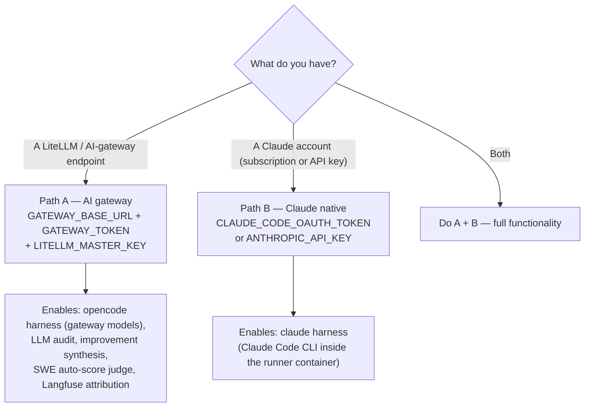

# Onboarding — run the lab for the first time

Step-by-step setup for a developer cloning the lab on a **new machine**. At the end
you will have the web app running, one benchmark run executed, and the improvement
loop within reach.

Already set up? Jump to [Operating the lab](#7-what-next--operating-the-lab).

---

## 1. Prerequisites

| Tool | Why | Check |
|---|---|---|
| **Docker Desktop** | The web app and every agent run in containers | `docker info` |
| **make** + **git** | All workflows are Makefile-driven | `make --version` |
| [uv](https://github.com/astral-sh/uv) *(optional)* | Only to develop the lab itself (tests, lint) | `uv --version` |
| **Node 20+** *(optional)* | Only for host-mode frontend development | `node --version` |

```bash
git clone https://github.com/marcosdh1987/ai-agentic-harness-lab.git
cd ai-agentic-harness-lab
cp .env.example .env
```

Everything below is about filling in `.env` (it is gitignored — keys never get
committed) and starting the stack.

## 2. Choose your credential path

The lab has **two independent credential surfaces**. You can start with either, but
most features light up with both:



| Feature | Needs Path A (gateway) | Needs Path B (Claude) |
|---|---|---|
| `opencode` harness runs (gateway-routed models, incl. self-hosted) | ✅ | — |
| `claude` harness runs | — | ✅ |
| Behavioural **audit** ("Run audit" button) | ✅ | — |
| **Improvement proposals** / sanitized issue synthesis | ✅ | — |
| SWE-bench Pro **auto-scoring** (LLM judge) | ✅ | — |
| Per-run cost/attribution in Langfuse | ✅ | — |

> **TL;DR:** with only Path B you can benchmark the `claude` harness, but the
> audit → improvement loop needs the gateway. Set up **Path A first** if you can.

### Path A — AI gateway (LiteLLM) — recommended

The lab expects an OpenAI-compatible gateway (LiteLLM is the tested one). It routes
model calls for the `opencode` harness, the audit/improvement LLMs, and creates
**per-run virtual keys** so every run is attributable in Langfuse.

In `.env`:

```bash
# Your gateway endpoint — MUST end in /v1
GATEWAY_BASE_URL=http://localhost:4000/v1
# The LiteLLM master key (or a virtual key with model access)
GATEWAY_TOKEN=sk-...
# Master key again — used to mint per-run virtual keys with session tags
LITELLM_MASTER_KEY=sk-...
```

Optional model overrides (LiteLLM model names, no `gateway/` prefix):

```bash
# AUDITOR_MODEL=gpt-5.4-mini       # behavioural audits (default gpt-5.5)
# IMPROVE_MODEL=gpt-5.4-mini       # improvement-issue synthesis (defaults to AUDITOR_MODEL)
# CASE_SUMMARY_MODEL=gpt-5.4-nano  # SWE-bench Pro import polish (nano-tier is plenty)
```

Then pull the gateway's live model list into the lab (repeat whenever you add
models to the gateway):

```bash
make sync-gateway-models   # model dropdowns in the UI come from this
make opencode-doctor       # sanity: gateway + local endpoints reachable
```

Don't have a gateway yet? A minimal LiteLLM setup is one container + one YAML —
see the [LiteLLM docs](https://docs.litellm.ai/docs/proxy/quick_start). Point it
at any provider (OpenAI, Anthropic, Bedrock, your LM Studio/Ollama servers) and
the lab consumes them uniformly as `gateway/<model>`.

### Path B — Claude Code with your own account

The `claude` harness runs the Claude Code CLI **inside the runner container**; it
needs credentials via `.env`. Use **either**:

**Option 1 (recommended) — your Claude subscription.** On your **host** terminal:

```bash
# Install the Claude Code CLI if you don't have it yet:
npm install -g @anthropic-ai/claude-code

# Generate a long-lived token (opens a browser to authorize with your account):
claude setup-token
```

Copy the token it prints (starts with `sk-ant-oat...`) and paste it into `.env`:

```bash
CLAUDE_CODE_OAUTH_TOKEN=sk-ant-oat01-...
```

**Option 2 — pay-as-you-go Anthropic API key** (from
[console.anthropic.com](https://console.anthropic.com/settings/keys)):

```bash
ANTHROPIC_API_KEY=sk-ant-...
```

Restart the stack after editing `.env` (`make stop-docker && make app-up`) — the
token flows into the runner container from there. No gateway involvement for the
runs themselves. Design details: [harness-adapters.md](harness-adapters.md).

### Path C — other harnesses and backends

| You want | Path | Guide |
|---|---|---|
| **codex** harness | Host mode (`make app-host`) — codex drives your host CLI's native OpenAI login; not wired in Docker yet | [runbook-claude-codex.md](runbook-claude-codex.md) |
| **Self-hosted models** (LM Studio / Ollama) | Route them through your LiteLLM gateway (recommended: build profile + Langfuse visibility) or point `OLLAMA_BASE_URL` / `LMSTUDIO_BASE_URL` directly | [local-model-runtime-config.md](local-model-runtime-config.md) — start with "Priority order"; sizing: [task-sizing.md](task-sizing.md) |
| **antigravity** | Human-driven flow (not executed by the runner) | [harness-adapters.md](harness-adapters.md) |

## 3. Point the lab at the governance template (once)

The lab benchmarks and improves the [`ml-python-base`](https://github.com/marcosdh1987/ml-python-base)
governance (skills, agents, rules). Add it as a git remote so you can pull and
compare versions:

```bash
make template-remote-setup
# fork or HTTPS instead:
make template-remote-setup TEMPLATE_REPO=https://github.com/<you>/ml-python-base.git

make harness-status   # confirms: installed governance version vs latest release
```

## 4. Start the lab

```bash
make app-up
```

This builds the per-run runner image and starts four services:

| Service | Where |
|---|---|
| Frontend (web UI) | http://localhost:5173 |
| API (FastAPI) | http://localhost:8008 |
| Celery worker + Redis | internal |
| Runner | one container **per run**, created on demand |

Stop everything with `make stop-docker`.

> **Host mode (alternative):** `make app-host` runs the worker/API on your host so
> harnesses reuse your host CLI sessions (needed for codex). See the comments above
> `app-host` in the `Makefile`.

## 5. Smoke test — your first run

1. Open **http://localhost:5173** → **Runs** → **New run**.
2. Pick a simple case (e.g. `tetris-v1`), a **harness** you configured
   (`claude` for Path B, `opencode` for Path A), a governance-loaded **prompt
   variant** (`sdlc_full` / `swe_harness`), and an **executor model**
   (the dropdown is fed by `make sync-gateway-models` for gateway models).
3. Create the run and watch the logs stream. When it finishes:
   - **SWE-bench (Pro)** cases auto-score; custom cases wait for your manual score
     (state `awaiting_manual_score` — submit it in the run detail).
4. In the run detail, click **Run audit** (needs Path A) — the LLM reads the run's
   artifacts and reports skill usage, loops, and SDLC adherence.

If all of that worked, your machine is fully onboarded.

**Something failed?**

| Symptom | Check |
|---|---|
| Model dropdown empty | `make sync-gateway-models`; `GATEWAY_BASE_URL` ends in `/v1`; gateway reachable from Docker (use `host.docker.internal`, not `localhost`, when the gateway runs on your host) |
| `claude` run fails auth | `CLAUDE_CODE_OAUTH_TOKEN` (or `ANTHROPIC_API_KEY`) set in `.env` **before** `make app-up`; restart the stack after editing `.env` |
| Audit button errors with gateway config | `GATEWAY_TOKEN` + `GATEWAY_BASE_URL` in `.env`, then restart |
| Runs stuck in `pending` | worker logs: `docker compose logs -f worker` |
| Every step logs `stream error` (gateway model) | The self-hosted server behind that model (LM Studio / Ollama / NIM host) is off or unreachable from the gateway — start it and re-run. Run creation preflights this and rejects with a clear error when the backend is provably down (skip with `HARNESS_LAB_DISABLE_GATEWAY_PROBE=1`) |
| No run attribution in Langfuse | `LITELLM_MASTER_KEY` matches your gateway's master key |

## 6. Optional — develop the lab itself

```bash
make install       # pin Python, create .venv, sync deps (uv)
make setup-hooks   # pre-commit hooks
make ci            # read-only quality gate: ruff, mypy, bandit, pytest
cd frontend && npm install && npx tsc --noEmit   # frontend typecheck
```

A Dev Container config is included (VS Code → "Reopen in Container") for a
zero-setup Linux environment.

## 7. What next — operating the lab

Once set up, your day-to-day is the **improvement cycle**: run → audit → propose →
file an issue → improve the template → re-measure.

| I want to… | Read |
|---|---|
| Understand every screen of the web UI | [guide-web-ui.md](guide-web-ui.md) |
| Run the audit → proposals → GitHub-issue loop | [improvement-cycle.md](improvement-cycle.md) |
| The methodology behind the loop (when to trust a proposal) | [harness-lifecycle/improvement-methodology.md](harness-lifecycle/improvement-methodology.md) |
| Consolidate proposals from several runs into ONE issue | Improvements menu in the UI (saved-proposals worklist) — see [guide-web-ui.md](guide-web-ui.md) |
| Adopt a new template release and validate it | [harness-lifecycle/lab-sync-workflow.md](harness-lifecycle/lab-sync-workflow.md) |
| Benchmark with SWE-bench / SWE-bench Pro | [design-swe-bench-cases.md](design-swe-bench-cases.md), [design-swe-bench-pro-lane.md](design-swe-bench-pro-lane.md) |
| Compare harnesses (claude vs codex vs opencode) | [harness-adapters.md](harness-adapters.md), [runbook-claude-codex.md](runbook-claude-codex.md) |
| Tune self-hosted/local models so they converge | [local-model-runtime-config.md](local-model-runtime-config.md), [task-sizing.md](task-sizing.md) |
