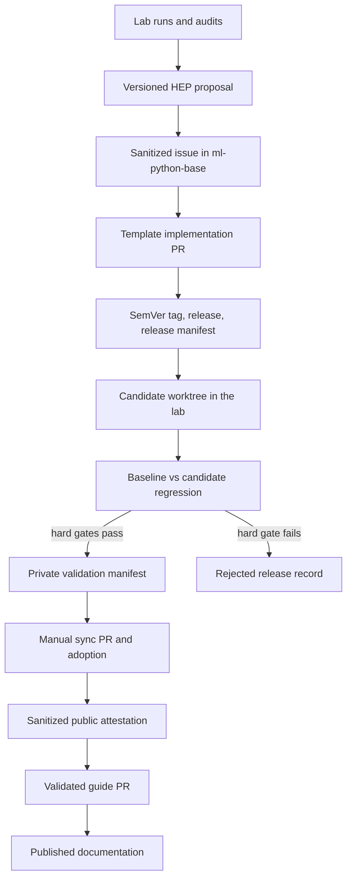
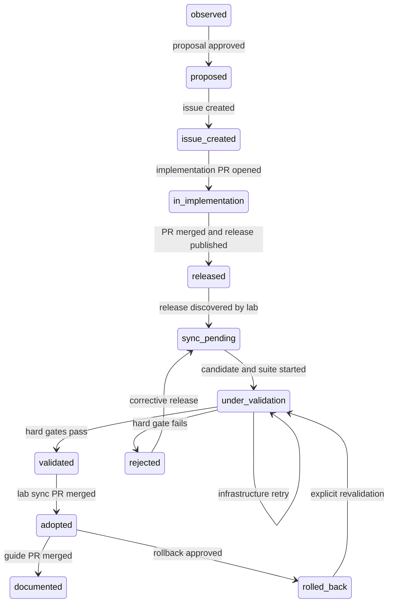

# Harness Continuous Improvement Cycle Implementation Plan

> **For agentic workers:** REQUIRED SUB-SKILL: use
> `subagent-driven-development` (recommended) or `executing-plans` to implement
> this plan task by task. Use TDD for behavior changes. Do not create commits,
> tags, pushes, releases, issues, pull requests, or branch integrations unless a
> human explicitly requests that operation.

**Goal:** Establish a controlled cycle in which private experimental evidence
from the lab produces traceable improvements in `ml-python-base`, every template
release is compared with the currently installed baseline before adoption, and
the public guide documents only exact releases approved by the lab.

**Architecture:** `ml-python-base` remains the only authoritative source for
shared governance, skills, agents, adapter templates, and synchronization
platform code. The lab owns experiments, proposals, candidates, regression
results, adoption state, and private validation records. The guide consumes an
exact template tag plus a public, sanitized validation attestation.

**Tech stack:** Python 3.11, Pydantic/SQLModel, YAML and JSON Schema, Make, Git
worktrees, Celery/Redis, Docker, GitHub CLI, GitHub Actions, React/TypeScript,
and MkDocs.

**Plan status:** approved for future implementation; no implementation started.

**Plan owner repository:** `marcosdh1987/ai-agentic-harness-lab`

**Repositories in scope:**

- `marcosdh1987/ai-agentic-harness-lab` (private experimental lab)
- `marcosdh1987/ml-python-base` (public authoritative template)
- `marcosdh1987/harness-engineering-guide` (public documentation)

---

## How to use and update this plan

This file is the durable progress ledger for the initiative. Keep it on a
dedicated planning branch until implementation begins. During implementation:

1. Create one small implementation branch and pull request per roadmap item.
2. Mark a task or milestone complete only after the validation listed for it
   passes and the evidence link is recorded here.
3. Add the PR, release, run, report, or documentation URL to the corresponding
   evidence field.
4. Do not rewrite completed history. If a completed item is later invalidated,
   add a dated note and reopen its checkbox.
5. Keep implementation details in the repository that owns them; this plan
   coordinates the cycle but does not become a second source of truth.

### Overall progress

- [ ] Milestone 1 — Authoritative template and release contract
- [ ] Milestone 2 — Versioned proposals and safe candidate synchronization
- [ ] Milestone 3 — Canonical baseline/candidate regression validation
- [ ] Milestone 4 — Adoption, rejection, and rollback
- [ ] Milestone 5 — Validated guide publication
- [ ] Milestone 6 — First complete manual end-to-end cycle
- [ ] Milestone 7 — Backend/UI lifecycle surface
- [ ] Milestone 8 — Optional cross-repository automation

### Evidence ledger

| Milestone | Status | Evidence | Notes |
|---|---|---|---|
| 1 | In progress | [`ml-python-base` PR #27](https://github.com/marcosdh1987/ml-python-base/pull/27), merge `a97e98c`; branch `feat/harness-traceable-release-contract`; `make ci` (64 tests) and pre-commit green on 2026-07-22 | Phase 1 is merged. Phase 2 implementation is ready for review; its PR, merge, baseline tag, GitHub Release, and release asset are still pending. |
| 2 | Not started | — | — |
| 3 | Not started | — | — |
| 4 | Not started | — | — |
| 5 | Not started | — | — |
| 6 | Not started | — | — |
| 7 | Not started | — | Outside the operational MVP |
| 8 | Not started | — | Outside the operational MVP |

---

## 1. Executive summary

The implementation is divided into four operational capabilities and two later
enhancements:

1. Regularize the public template as the source of truth and give it a real,
   traceable SemVer release process.
2. Give the lab versioned proposals, installed/candidate manifests, and safe
   selective synchronization in isolated worktrees.
3. Add a canonical regression suite that compares the installed baseline with
   a candidate release, produces hard gates and warnings, and supports adoption
   or rollback.
4. Require the guide to consume an exact tag with an approved public validation
   attestation.
5. After the manual process is proven, expose it through the lab backend and UI.
6. After at least two successful manual cycles, automate preparation with a
   GitHub App while retaining manual merge and adoption decisions.

The MVP is intentionally manual at repository boundaries. It may invoke `gh`
after explicit operator approval, but it must not auto-merge, auto-push, or
automatically publish releases.

---

## 2. Current state found during inspection

### 2.1 `ai-agentic-harness-lab`

Inspected state: clean `main` at `ccc3366` after the SWE-bench Pro merge.

Existing capabilities to reuse:

- Custom cases, SWE-bench, and SWE-bench Pro lanes.
- OpenCode and Claude Code execution from runner containers.
- Celery + Redis with one Docker container per run.
- Cancellation, retry, orphan reconciliation, and persisted run events.
- Per-run metadata, logs, diff, usage, validation, attribution, and LLM audit.
- `condition_hash`, `harness_fingerprint`, prompt/case hashes, Git provenance,
  runner identity, and skill ablation metadata.
- Objective, subjective, cost, effort, and composite validation dimensions.
- LLM-generated improvement suggestions through `make improve`.
- Web UI for cases, runs, artifacts, comparison, staged skills, and proposals.
- A selective governance sync script and an explicit governance path allowlist.
- A currently green `make check-sync` gate.

Gaps and risks:

- There is no `.template-version`, `.harness-version.yaml`, or configured
  `template` remote, so the documented template sync cannot currently run.
- There is no candidate, suite, suite-run, or release-validation domain model.
- `improvements.json` lacks a schema, stable proposal ID, lifecycle, strict
  validation, and durable tracked storage.
- Run artifacts live under the Git-ignored `data/runs/` hierarchy.
- The current sync performs `git checkout <ref> -- <paths>`, which updates the
  working tree and index and can overwrite local changes.
- The current preview does not fully model deletes, generated artifacts,
  conflicts, forbidden paths, or platform compatibility.
- The sync command has no dirty-tree guard.
- The lab contains a local `skills_sync/renderer.py` skill-override feature
  required by ablation, but that behavior is absent from `ml-python-base`.
- There is no automated baseline/candidate comparison or gate evaluation.
- The UI has no installed/latest version, candidate, suite, decision, or
  rollback concepts.

### 2.2 `ml-python-base`

Inspected state: clean `main` at `4e2c2b1`, matching `origin/main`.

Existing capabilities to reuse:

- Authoritative `.github/` governance, skills, and agent definitions.
- Declarative adapters for Claude, OpenCode, Antigravity, Codex, and Copilot.
- `skills_sync`, `skills-lock.json`, adapter rendering, and drift validation.
- Selective governance synchronization and a documented path allowlist.
- `CHANGELOG.md` and a preliminary `template-release` target.
- Read-only `make check`, `make ci`, and `make check-sync` gates.
- A currently green `make check-sync` gate.

Gaps and risks:

- No remote SemVer tags or GitHub Releases exist.
- `pyproject.toml` declares `0.1.0`, while the changelog already has `0.2.0`.
- The current release target mutates version files, creates a commit, and
  creates a tag without a complete preflight.
- There are no checks for proposal/issue/PR provenance, manifest compatibility,
  release schema, tag collision, or generated/source consistency.
- `template_sync.py` has no focused tests and is copied into consumers without
  a declared protocol version.
- `adapters/registry.toml` has no synchronization protocol metadata.
- The shared renderer lacks the ablation override already used by the lab.

### 2.3 `harness-engineering-guide`

Inspected state: clean `main` at `8365968`; `make docs-build` passes strictly.

Existing capabilities to reuse:

- Bilingual MkDocs site.
- Machine-readable template snapshot.
- Generated English and Spanish reference pages.
- `make sync-reference` and strict documentation build.
- A workflow that opens a reference-update PR.
- A remote sync branch already demonstrating snapshot generation from the
  current template commit.

Gaps and risks:

- Sync consumes the current local/remote `main`, not a required exact tag.
- There is no `REF` verification, detached checkout, release manifest, or
  validation manifest check.
- The weekly schedule can propose documentation for an unvalidated commit.
- No reference lock or approved-version history exists.
- The generator has no automated tests.
- Generated pages show branch/commit, but not release, regression suite,
  validation outcome, or attestation.

---

## 3. Problems and risks to solve

1. Experimental platform changes can remain authoritative only in the lab.
2. Template versions and changelog entries can diverge.
3. Sync can overwrite or stage unrelated local work.
4. Consumers can use mutable `main` instead of immutable releases.
5. The guide can publish before the lab validates a release.
6. LLM proposals can be malformed, duplicated, or leak private evidence.
7. Comparisons can accidentally vary model, prompt, case, or runtime together
   with the harness.
8. One stochastic run can be mistaken for a reliable regression result.
9. Governance changes can be mixed with dangerous platform changes.
10. Concurrent runs can mutate shared generated adapter state.
11. Rollback can lose the evidence and decision trail.
12. Public issues and docs can expose private run data or local paths.
13. GitHub automation credentials can acquire excessive cross-repository scope.

---

## 4. Target architecture



Architecture invariants:

- Shared artifacts are edited only in `ml-python-base`.
- Lab overrides are ephemeral experimental inputs, never a promoted source.
- Every adopted input is an immutable SemVer tag resolved to a full SHA.
- Governance sync and platform sync are separate channels and separate PRs.
- No command merges a branch, pushes, or auto-merges a PR.
- Adoption becomes effective only when the reviewed lab sync PR reaches `main`.
- The guide rejects `failed`, `rejected`, `cancelled`, or `rolled_back`
  validation states.
- Raw evidence remains private; only a sanitized aggregate attestation is
  copied to the guide.

---

## 5. Repository responsibilities

| Repository | Owns | Must not own |
|---|---|---|
| Lab | Experiments, evidence, proposals, candidates, suite execution, reports, adoption history, rollback | Independent promoted copies of shared harness components |
| `ml-python-base` | Shared sources, release contract, SemVer releases, compatibility metadata | Private benchmark runs or lab adoption decisions |
| Guide | Exact validated reference snapshots and public attestations | Validation decisions or latest-`main` publication |

Additional ownership rules:

- Improvements to shared process documentation also enter `ml-python-base`
  first when they affect shipped governance.
- Guide-only educational prose can be changed directly in the guide, but it
  cannot claim a template capability not present in the referenced tag.
- The lab may keep local operational configuration outside shared governance
  paths.

---

## 6. Data model and manifests

### 6.1 Versioned experimental proposal

Tracked location:

```text
data/harness-proposals/<year>/<proposal-id>.yaml
```

Example:

```yaml
schema_version: 1
proposal_id: HEP-2026-014
title: Improve systematic debugging stop conditions
status: proposed
created_at: 2026-07-22T12:00:00Z

source:
  repository: marcosdh1987/ai-agentic-harness-lab
  runs:
    - run_id: custom-debug-loop-claude-sdlc-003
      condition_hash: sha256:...
      artifacts:
        audit: data/runs/custom-debug-loop-claude-sdlc-003/audit.md
        metadata_sha256: sha256:...

observation:
  failure_mode: Agent repeated an equivalent failing command.
  expected_behavior: Reframe the hypothesis after the retry budget.
  evidence_summary: Seen in two independent runs.

affected_artifacts:
  - .github/skills/systematic_debugging/SKILL.md
  - .github/orchestration.md

suggested_change:
  summary: Add an explicit retry budget and hypothesis reset rule.

validation:
  suggested_cases:
    - systematic-debugging-v1
  success_criteria:
    - metric: repeated_equivalent_command_max
      operator: lte
      value: 2
    - metric: objective_passed
      operator: eq
      value: true

confidence: high

links:
  source_issue: null
  source_pull_requests: []
  releases: []
  validations: []
  guide_pull_request: null

lifecycle:
  - state: observed
    at: 2026-07-22T11:40:00Z
    actor: lab
  - state: proposed
    at: 2026-07-22T12:00:00Z
    actor: human
```

Rules:

- Proposal IDs use `HEP-YYYY-NNN` and are allocated under a lifecycle lock.
- YAML is the reviewed source of truth; DB rows are indexes for the UI.
- Every referenced run records its `condition_hash` and evidence checksums.
- A public issue preview is generated separately and sanitized.
- Issue creation is idempotent once `links.source_issue` is set.
- Editing a proposal after issue creation appends a lifecycle event and requires
  an explicit issue update; it never silently changes public history.

### 6.2 Template release manifest

Artifact name:

```text
harness-release-vX.Y.Z.yaml
```

It is generated after the tag exists and attached manually to the GitHub
Release. It is not committed with a self-referential commit SHA.

```yaml
schema_version: 1
release:
  repository: marcosdh1987/ml-python-base
  version: 0.5.0
  ref: v0.5.0
  commit: <full-sha>
  published_at: 2026-07-22T15:00:00Z

compatibility:
  sync_protocol: 1
  minimum_consumer_protocol: 1
  breaking: false
  migration_document: null

channels:
  governance:
    paths:
      - .github/skills
      - .github/skills-external
      - .github/agents
      - .github/architecture.md
      - .github/standards.md
      - .github/domain-boundaries.md
      - .github/sdlc.md
      - .github/orchestration.md
      - .github/automation.md
      - .github/portability.md
      - adapters/templates
  platform:
    changed: false
    paths: []

provenance:
  proposals: [HEP-2026-014]
  source_issues: [marcosdh1987/ml-python-base#31]
  source_pull_requests: [marcosdh1987/ml-python-base#32]

artifacts:
  governance_tree_sha256: sha256:...
  skills_lock_sha256: sha256:...
  registry_sha256: sha256:...
```

### 6.3 Installed version manifest

Canonical tracked file in the lab:

```text
.harness-version.yaml
```

```yaml
schema_version: 1
installed:
  repository: marcosdh1987/ml-python-base
  ref: v0.5.0
  commit: <full-sha>
  channel: governance
  adopted_at: 2026-07-24T10:00:00Z

sync:
  protocol: 1
  tools: [claude, opencode, codex, copilot, antigravity]
  paths: []
  release_manifest_sha256: sha256:...

validation:
  validation_id: HV-2026-007
  status: passed
  suite: harness-regression-v1
  report: data/harness-validations/v0.5.0/HV-2026-007/report.json
```

Compatibility policy:

- `.harness-version.yaml` is canonical.
- `.template-version` remains a generated legacy mirror for at least two
  template releases.
- If only `.template-version` exists, status is `legacy_unverified`.
- Candidate state never overwrites installed state before adoption.

### 6.4 Private validation manifest

Tracked location:

```text
data/harness-validations/<version>/<validation-id>/validation.yaml
```

Required contents:

- Baseline and candidate refs, full SHAs, and harness fingerprints.
- Release manifest digest and sync protocol.
- Suite version, case definitions, repetitions, model/runtime controls.
- All child run IDs and terminal states.
- Metrics by run and aggregated by case/arm.
- Hard-gate, warning, and informational outcomes.
- Decision, actor, reason, timestamps, and retry lineage.
- Proposal, issue, PR, release, sync PR, and guide links.
- Checksums for JSON and Markdown reports.
- State: `running`, `passed`, `failed`, `cancelled`, `rejected`, `adopted`, or
  `rolled_back`.

### 6.5 Public guide attestation

Tracked location in the guide:

```text
docs/reference-data/validations/vX.Y.Z.yaml
```

It keeps only:

- Template version, ref, full SHA, release URL, and validation date.
- Suite ID/version and aggregate gate outcomes.
- Aggregate metrics approved for publication.
- `sanitized: true` and the digest of the private manifest.
- No raw logs, prompts, private URLs, local paths, tokens, model credentials,
  or sensitive run IDs.

---

## 7. End-to-end workflow

1. Run lab cases and produce objective validation, attribution, and LLM audit.
2. Run `make harness-proposal RUN=<id>` to generate a proposal draft and public
   issue preview.
3. Review evidence, wording, target artifacts, validation criteria, and public
   sanitization.
4. Run `make harness-proposal-issue PROPOSAL=<id> CREATE=1` to create the
   template issue explicitly.
5. Implement the change in a small `ml-python-base` PR linked to the proposal
   and issue.
6. Run template checks and merge manually.
7. Update version/changelog and run `make harness-release-check VERSION=X.Y.Z`.
8. Create and push the tag manually, create the GitHub Release manually, and
   attach the generated release manifest.
9. In the lab, run `make harness-status` and `make harness-sync-preview
   REF=vX.Y.Z`.
10. Run `make harness-sync-branch REF=vX.Y.Z` to create an isolated candidate
    worktree and branch.
11. Run `make harness-regression REF=vX.Y.Z`.
12. Run `make harness-validation-report REF=vX.Y.Z` to evaluate gates.
13. If failed, reject the candidate and retain all evidence.
14. If passed, run `make harness-adopt REF=vX.Y.Z` in the candidate worktree.
15. Open, review, and merge the lab sync PR manually.
16. Generate the public sanitized validation attestation.
17. In the guide, run `make sync-validated-reference REF=vX.Y.Z
    VALIDATION_MANIFEST=<path>`.
18. Build docs, open a guide PR, review, and merge manually.

---

## 8. Lifecycle states and transitions



| Transition | Trigger | Recorded in | Required artifact | Retry/rollback |
|---|---|---|---|---|
| observed → proposed | Human approves proposal draft | Lab | Proposal YAML | Edit before issue |
| proposed → issue_created | `gh issue create` succeeds | Lab + template | Issue URL/number | Idempotent retry |
| issue_created → in_implementation | PR is linked | Template | PR URL | New PR if closed |
| in_implementation → released | PR merged, tag/release published | Template | Release manifest | Corrective release |
| released → sync_pending | Lab resolves new release | Lab | Candidate record | Retry discovery |
| sync_pending → under_validation | Worktree and suite start | Lab | Validation manifest | Resume after infra failure |
| under_validation → validated | All hard gates pass | Lab | Signed-off report | Re-run creates new ID |
| under_validation → rejected | Hard gate fails or human rejects | Lab | Rejection reason | Requires corrective release |
| validated → adopted | Lab sync PR reaches `main` | Lab | Installed manifest | Rollback PR |
| adopted → documented | Guide PR reaches `main` | Guide | Reference lock | Publish previous version |
| adopted → rolled_back | Rollback PR reaches `main` | Lab | Rollback validation | Revalidate later |

Retry never overwrites an existing validation. A retry creates a new validation
ID with `retry_of`. Functional rejection is terminal for that release unless a
human records an exceptional override; infrastructure failures may retry the
same release.

---

## 9. Make command contracts

### 9.1 Lab commands

| Target | Script/module | Preconditions | Writes | Expected output |
|---|---|---|---|---|
| `harness-status` | `harness_lifecycle.cli status` | Git repo | None | Installed/latest/candidate/drift/compatibility |
| `harness-proposal RUN=` | `... proposal` | Run + audit exist | Proposal YAML/preview unless dry run | ID, paths, validation result |
| `harness-proposal-issue PROPOSAL=` | `... proposal-issue` | Valid reviewed proposal, `gh` for create | Proposal link when `CREATE=1` | Public issue preview or URL |
| `harness-sync-preview REF=` | `... sync-preview` | SemVer tag reachable | None except Git fetch metadata | Source/generated diff and blockers |
| `harness-sync-branch REF=` | `... sync-branch` | Clean tree, compatible release | Branch/worktree/candidate manifest | Worktree path and review commands |
| `harness-regression REF=` | `... regression` | Candidate worktree + suite | DB rows and run artifacts | Validation ID and progress |
| `harness-validation-report REF=` | `... report` | Terminal child runs | YAML/JSON/Markdown reports | Gate summary |
| `harness-adopt REF=` | `... adopt` | Passed validation | Installed and legacy manifests | Review instructions |
| `harness-reject REF= REASON=` | `... reject` | Candidate exists | Lifecycle event/report status | Rejection record |
| `harness-rollback REF= REASON=` | `... rollback` | Previously validated ref | Rollback branch/worktree/manifests | Review instructions |
| `harness-cancel VALIDATION_ID=` | `... cancel` | Active suite | Cancellation signal/events | Cancelled child count |
| `harness-clean VALIDATION_ID=` | `... clean` | Terminal suite | Removes only explicit worktree/temp state | Preserved artifact list |

Common behavior:

- `REF` must match `vMAJOR.MINOR.PATCH`; adoption never accepts `main`, a bare
  branch, or an unresolved tag.
- Preview is read-only and may run with a dirty tree.
- Sync, adopt, rollback, and cleanup reject a dirty main worktree.
- No automatic stash is allowed.
- `DRY_RUN=1` creates no branch, worktree, DB row, manifest, issue, or file.
- Docker operation uses the same Python CLI and
  `HARNESS_LIFECYCLE_WORKDIR`; host paths are resolved explicitly for sibling
  runner bind mounts.
- Mutating commands acquire both a file lock and a DB lifecycle lock.
- Commands never commit, push, merge, or publish.

Standard exit codes:

| Code | Meaning |
|---|---|
| `0` | Success |
| `2` | Invalid arguments or malformed manifest |
| `3` | Failed precondition or dirty tree |
| `4` | Sync protocol/platform incompatibility |
| `5` | Conflict, drift, or forbidden-path change |
| `6` | Regression hard gate failed |
| `7` | Missing tag, release asset, external tool, network, or authentication |
| `130` | Cancelled |

### 9.2 Template commands

| Target | Behavior |
|---|---|
| `harness-change-summary BASE_REF=` | Read-only classification by governance/platform and SemVer recommendation |
| `harness-release-check VERSION=` | Read-only SemVer, version, changelog, tests, adapters, lock, drift, provenance, schema, and generated/source checks |
| `harness-release-manifest VERSION=` | Generate the release asset after the tag exists |
| `harness-release VERSION=` | Run preflight and print exact manual tag/release commands; no Git mutation |
| `harness-platform-summary BASE_REF=` | Identify platform changes and required migration notes |

SemVer policy:

- PATCH: compatible correction or clarification without a new capability.
- MINOR: additive compatible rule, skill, agent, template, or supported tool.
- MAJOR: removal, rename, contract break, incompatible registry/layout change,
  or sync protocol migration.
- Apply this strict policy even while the project is on `0.x`.

Release checks must verify:

- Clean working tree and exact `pyproject.toml`/changelog version match.
- Version is valid and tag does not already exist.
- Proposal IDs, issue URLs, and PR URLs are present when required.
- `make check`, `make check-sync`, skills lock, and adapter generation pass.
- Source/generated ownership is consistent.
- Release schema and compatibility fields validate.
- Governance and platform changes are correctly classified.
- Breaking changes include a migration document.

### 9.3 Guide commands

| Target | Behavior |
|---|---|
| `sync-reference REF=` | Development preview from an exact ref; output is explicitly unvalidated/non-publishable without an attestation |
| `sync-validated-reference REF= VALIDATION_MANIFEST=` | Require passed sanitized attestation, matching tag/SHA/schema, then update lock/snapshot/pages |
| `reference-status` | Read-only published version, commit, validation, and latest-known release |
| `docs-build` | Existing strict MkDocs build |

---

## 10. New scripts and modules

### 10.1 Lab package

```text
src/harness_lab_app/harness_lifecycle/
├── __init__.py
├── cli.py
├── models.py
├── manifests.py
├── proposals.py
├── releases.py
├── sync.py
├── suite.py
├── metrics.py
├── gates.py
├── reports.py
├── adoption.py
├── locking.py
└── sanitizer.py
```

Responsibilities:

- `models.py`: lifecycle enums and Pydantic contracts.
- `manifests.py`: load, validate, migrate legacy data, and write atomically.
- `proposals.py`: ID allocation, evidence extraction, validation, preview, and
  issue linkage.
- `releases.py`: SemVer validation, tag resolution, release asset retrieval,
  SHA and compatibility checks.
- `sync.py`: allowlists, source/generated diff, worktrees, conflicts, and
  forbidden-path assertions.
- `suite.py`: parse suite, create baseline/candidate child runs, resume/cancel.
- `metrics.py`: normalize and aggregate metrics, including repeated loops.
- `gates.py`: declarative hard gate/warning evaluation.
- `reports.py`: private YAML/JSON/Markdown and public attestation generation.
- `adoption.py`: adopt, reject, and rollback state changes without Git
  integration.
- `locking.py`: file/DB exclusion and stale lock recovery.
- `sanitizer.py`: public-field allowlist and secret/path detection.

Thin compatibility entry points:

- `scripts/harness_lifecycle.py` delegates to the package.
- `scripts/lab_improve.py` retains the legacy interface for one release and
  converts generated suggestions into proposal drafts.
- `scripts/template_sync.py` becomes a shim or a platform-managed copy; no new
  lifecycle logic is added there.
- Make targets contain no business logic.

### 10.2 Template

```text
scripts/harness_release.py
make/harness.mk
schemas/harness-release-v1.schema.json
```

### 10.3 Guide

```text
scripts/reference_validation.py
tests/test_reference_validation.py
tests/test_sync_reference_template.py
```

Add characterization tests before splitting the existing monolithic guide
generator.

---

## 11. Required changes by repository

### 11.1 Lab

- Add lifecycle package, schemas, fixtures, and tests.
- Store reviewed proposals outside ignored per-run directories.
- Replace direct-path checkout with safe preview and worktree synchronization.
- Add installed, candidate, validation, and rollback manifests.
- Add SQLModel entities: `HarnessCandidate`, `RegressionSuiteRun`, and
  `RegressionChildRun`.
- Add compatibility SQLite migrations following the existing migration style.
- Add Celery tasks for suite orchestration, cancellation, and recovery.
- Move promoted shared renderer behavior upstream, then consume it from a
  template release.
- Move truly lab-specific governance differences out of authoritative shared
  paths or propose them upstream.
- Add APIs and UI only after command-line workflow acceptance.

### 11.2 `ml-python-base`

- Upstream the skill-list override used by lab ablations and add tests.
- Declare synchronization protocol metadata.
- Add release preflight, manifest generation, JSON Schema, and documentation.
- Reconcile the package version and changelog before the first real release.
- Replace the release target that automatically commits/tags.
- Add issue template and expected labels:
  `lab-proposal`, `harness-governance`, `harness-platform`, `semver:patch`,
  `semver:minor`, `semver:major`, and `validation-required`.
- Document source-of-truth and generated files.

### 11.3 Guide

- Require exact `REF` checkout and record tag + SHA.
- Add public validation manifest verification and reference lock.
- Show version, commit, suite, status, date, and evidence links on generated
  pages.
- Remove scheduled publication from mutable `main`; retain manual dispatch.
- Keep `sync-reference` only as a development preview.
- Add generator and manifest tests.

---

## 12. Canonical regression suite

Location:

```text
benchmarks/harness-regression-v1/suite.yaml
```

MVP definition:

```yaml
schema_version: 1
suite_id: harness-regression-v1

execution:
  canary_repetitions: 3
  swebench_repetitions: 1
  sequential: true
  require_clean_harness: true

cases:
  - id: cli-textstats-v1
    role: simple-feature
    repetitions: 3
  - id: systematic-debugging-v1
    role: proposal-canary
    repetitions: 3
  - id: documentation-update-v1
    role: documentation
    repetitions: 3
  - id: pallets__flask-4992
    role: swebench-easy
    repetitions: 1

comparison:
  baseline: installed
  candidate: requested_ref
  controlled_fields:
    - case
    - prompt
    - executor_model
    - planner_model
    - temperature
    - max_steps
    - runner_image
```

`multi-file-refactor` and a medium SWE-bench case are post-MVP additions.

### Hard gates

- Tag, SHA, release manifest, and sync protocol are valid.
- Candidate changes only declared governance paths.
- Candidate `make check-sync` and `make check` pass.
- Fingerprints prove the harness is the only deliberate experimental variable.
- Deterministic canaries pass 3/3 candidate repetitions.
- No case that passed in baseline fails in candidate.
- The proposal-originating case meets its explicit success criterion.
- Candidate introduces no pathological loop of three or more consecutive
  normalized equivalent commands.
- No unplanned human intervention is required.
- Public attestation passes secret and private-path scanning.

### Warnings

- Median tokens, cost, or duration increase by more than 20%.
- Median steps increase by more than 25%.
- Composite score decreases by up to 0.5 without a functional failure.
- Repeated commands increase without reaching the pathological-loop gate.
- Candidate edits more files or produces a materially larger diff.
- A metric is unavailable in one or more runs.

### Informational metrics

- Functional success and test pass rate.
- SWE-bench resolved, F2P, and P2P.
- Skills consulted and governance coverage.
- Tool, command, and agent-mode distributions.
- Tokens, cost, wall time, steps, and interventions.
- Repeated loops, unnecessary files, and diff size.
- LLM behavioral audit findings.

Thresholds live in suite configuration, not hard-coded Python constants.

---

## 13. GitHub integration

### MVP: manual repository boundaries

- Proposal issue creation uses `gh` only with `CREATE=1` and operator review.
- Pull requests are opened manually.
- Tags, pushes, Releases, and release assets are published manually.
- Lab sync and guide publication produce local branches/changes for review.
- Every merge remains manual.
- No repository stores GitHub credentials.

### Later automation

1. Template Release publishes a `repository_dispatch` event to the lab.
2. A lab workflow runs on a trusted self-hosted runner with Docker/model access.
3. It prepares a candidate branch and draft PR.
4. It runs the regression suite and publishes checks/report links.
5. Human reviewers decide adoption and merge.
6. The lab generates an attestation and opens a guide PR.
7. The guide PR is manually reviewed and merged.

Future GitHub App permissions:

| Repository | Minimum permissions |
|---|---|
| Template | Metadata read, contents read, issues write, PR read, releases read |
| Lab | Metadata read, contents write, PR write, actions write |
| Guide | Metadata read, contents write, PR write |

Do not grant administration, secrets, organization members, or auto-merge.

---

## 14. Docker and test-server operation

- Fetch, checkout, and worktree creation run on the host or a dedicated trusted
  worker, not inside ephemeral agent runners.
- Forward an SSH agent socket and mount `known_hosts` read-only. Never copy an
  SSH key into an image.
- HTTPS credentials use a host credential helper or an ephemeral secret mount;
  they are never committed or baked into images.
- Only the worker receives `/var/run/docker.sock`; API and frontend do not.
- Treat Docker socket access as root-equivalent host access.
- Use `HARNESS_LIFECYCLE_WORKDIR`, for example
  `/srv/harness-lifecycle/worktrees/<validation-id>/`.
- Baseline and candidate use separate repository roots/worktrees.
- Persist lifecycle records under `data/harness-validations/`; keep raw run
  data under `data/runs/`.
- Acquire a DB lock plus a filesystem lock before sync/adopt/rollback.
- Run baseline and candidate sequentially in the MVP.
- Suite cancellation sets a persisted flag and propagates to active child runs.
- Worker startup moves orphaned active suites to `interrupted`; an operator can
  resume without deleting completed child runs.
- Keep worktrees until reports are generated and reviewed.
- Cleanup is explicit and target-scoped; it never accepts a broad directory.

---

## 15. Future frontend integration

Backend endpoints:

```text
GET  /api/harness/status
GET  /api/harness/releases
POST /api/harness/sync-preview
POST /api/harness/candidates
GET  /api/harness/candidates/{id}
POST /api/harness/validations
POST /api/harness/validations/{id}/cancel
POST /api/harness/validations/{id}/decision
POST /api/harness/adoptions
POST /api/harness/rollbacks
GET  /api/harness/history
```

UI surface:

- Installed version, latest release, commit, and compatibility.
- Changelog and release provenance.
- Clean/drift/candidate state.
- Separate source and generated diff preview.
- “Create sync run” action.
- Case/repetition regression progress.
- Baseline/candidate comparison.
- Hard gates, warnings, and informational metrics.
- Adopt/reject decision with mandatory reason.
- Version history and rollback preparation.
- Links to proposal, issue, PR, release, validation, sync PR, and guide.

The MVP UI never merges, pushes, publishes, or performs an unreviewed rollback.

---

## 16. Security requirements

- Validate every release ref using strict SemVer and resolve it to a full SHA.
- Pass refs, paths, and IDs as argument arrays; never interpolate them into a
  shell command.
- Use a closed governance allowlist and fail on unknown paths.
- Verify release and validation manifest checksums.
- Use atomic file writes with a temporary sibling and rename.
- Public output uses a field allowlist, not a denylist alone.
- Scan for tokens, key formats, internal endpoints, home paths, `.env` content,
  and private repository links before publication.
- Do not publish raw prompts, logs, diffs, or workspace paths.
- Record actor, time, and reason for adopt, reject, rollback, and override.
- Reject any guide manifest whose status is not `passed` or whose `sanitized`
  flag is not true.
- Recalculate derived fields in the backend instead of trusting frontend input.
- Keep Docker socket access restricted to the trusted worker.

---

## 17. Rejection and rollback

### Reject before adoption

1. Run `make harness-reject REF=<candidate> REASON="..."`.
2. Preserve candidate branch, worktree, runs, reports, and manifests.
3. Record `rejected` with actor, time, reason, and failed gates.
4. Block `harness-adopt` and public attestation generation.
5. Require a corrective template release for functional failures.

### Roll back an adopted version

1. Select a previously validated release.
2. Create `harness-rollback/<from>-to-<to>`.
3. Apply governance from the prior tag using the same sync engine.
4. Run at least the canonical canary subset; run the full suite when the
   original failure can affect functional behavior.
5. Generate a new validation record with `type: rollback`.
6. Update installed manifests in the rollback branch.
7. Open and merge a reviewed PR manually.

Governance-only rollback is allowed only when the currently installed platform
protocol supports the older governance release. Platform rollback is separate
and always manually reviewed.

Never delete historical evidence. The guide may retain historical pages, but it
must not present a rejected or rolled-back release as the active reference.

---

## 18. Migration strategy

1. Record a frozen inventory of current shared paths.
2. Upstream the lab renderer override to `ml-python-base`.
3. Classify current `automation.md` and `portability.md` drift:
   - upstream shared improvements;
   - move lab-only configuration outside shared paths.
4. Add release tooling and reconcile version/changelog.
5. Publish the first real baseline release, recommended `v0.2.0`, manually.
6. Configure the lab `template` remote.
7. Bootstrap `.harness-version.yaml` from the baseline release.
8. Generate `.template-version` as the legacy mirror.
9. Add suite/manifests without UI changes.
10. Replace mutable scheduled guide sync with validated manual sync.
11. Execute and document the first complete manual cycle.
12. Add API/UI only after the command workflow is proven.

Compatibility outcomes:

| Condition | Required behavior |
|---|---|
| Only legacy `.template-version` exists | Report `legacy_unverified`; allow migration, block silent adoption |
| Tag does not exist | Exit 7; never fall back to `main` |
| Release has no manifest | Allow preview with warning; block adoption |
| Skill layout changed | Require migration note; consider MAJOR |
| `registry.toml` changed | Classify as platform; stop governance-only sync |
| New tool added | Require platform/registry upgrade first |
| Dirty working tree | Preview allowed; mutating operations exit 3 |
| Local/upstream conflict | Preserve both; candidate state becomes `conflicted` |
| Consumer protocol too old | Exit 4 with required platform version |

---

## 19. Implementation phases and tracked tasks

### Phase 1 — Authoritative template and shared engine

**Status:** Completed and merged on 2026-07-22 via
[`ml-python-base` PR #27](https://github.com/marcosdh1987/ml-python-base/pull/27)
at merge commit `a97e98c`. Post-merge verification passed `make check` (50
tests, 88% coverage) and `make check-sync` with no drift.

| Field | Content |
|---|---|
| Objective | Remove shared-engine drift and establish explicit governance/platform ownership. |
| Repository | `ml-python-base` |
| Files | Renderer/tests, registry metadata, lifecycle ownership docs. |
| Dependencies | None. |
| Implementation | Upstream skill override; inventory paths; define sync protocol. |
| Validation | Focused renderer tests, `make check-sync`, `make check`. |
| Risks | Accidentally shipping lab-only behavior as a generic contract. |
| Rollback | Revert PR before a release; corrective release afterward. |
| Complexity | Medium |

- [x] Write failing renderer override tests.
- [x] Verify tests fail because `render_tool(..., skills=...)` is unsupported.
- [x] Implement the minimal compatible override in the template.
- [x] Verify default rendering remains byte-identical.
- [x] Add explicit sync protocol metadata.
- [x] Document governance and platform path ownership.
- [x] Compare lab/template shared paths and resolve every unexplained drift.
- [x] Run template gates.
- [x] Record PR and test evidence in the ledger.

### Phase 2 — Traceable template release contract

**Status:** Implementation and local validation completed on 2026-07-22 in
`feat/harness-traceable-release-contract`. The work remains uncommitted and
unpublished pending human review, PR creation, merge, and the manual baseline
release. Verification: 14 focused release tests, 64 full tests, `make ci`,
pre-commit, JSON Schema parsing, Make target smoke tests, and no sync drift.

| Field | Content |
|---|---|
| Objective | Produce coherent SemVer releases and machine-readable provenance. |
| Repository | `ml-python-base` |
| Files | Release CLI/schema/Make include, changelog, version, docs, issue template, CI. |
| Dependencies | Phase 1. |
| Implementation | Read-only preflight, manifest generation, manual release instructions. |
| Validation | Temporary Git repo tests, schema fixtures, full template gates. |
| Risks | Version/tag mismatch or incomplete provenance. |
| Rollback | Revert PR before publishing; never move a published tag. |
| Complexity | Medium |

- [x] Write failing tests for invalid SemVer, mismatched version/changelog,
  existing tag, missing provenance, and incompatible platform changes.
- [x] Add `harness-release-v1` JSON Schema.
- [x] Implement `harness_release.py` with argument-array subprocess calls.
- [x] Add `make/harness.mk` and include it from the Makefile.
- [x] Replace automatic commit/tag behavior with a read-only/preparation flow.
- [x] Add the structured harness improvement issue template.
- [x] Add release-check workflow without publication.
- [x] Reconcile `pyproject.toml` and `CHANGELOG.md` for the baseline release.
- [x] Run all gates and record evidence.
- [ ] Human publishes the baseline tag/release/asset in a later explicit step.

### Phase 3 — Versioned lab proposals

| Field | Content |
|---|---|
| Objective | Convert run evidence into durable, schema-validated, sanitized proposals. |
| Repository | Lab |
| Files | Lifecycle models/manifests/proposals/sanitizer, legacy adapter, tests, docs. |
| Dependencies | Proposal contract agreed; template issue template available. |
| Implementation | Stable IDs, atomic writes, issue preview, idempotent issue linkage. |
| Validation | Unit/schema/sanitization tests and CLI dry runs. |
| Risks | LLM hallucination, duplicate issues, private-data leakage. |
| Rollback | Retain legacy `make improve` for one release. |
| Complexity | Medium |

- [ ] Write failing tests for proposal parsing, ID allocation, evidence hashes,
  atomic writes, idempotence, and public sanitization.
- [ ] Implement proposal Pydantic models and YAML storage.
- [ ] Implement public issue preview with a strict field allowlist.
- [ ] Adapt `lab_improve.py` to create proposal drafts.
- [ ] Add `harness-proposal` and `harness-proposal-issue` targets.
- [ ] Add proposal workflow documentation.
- [ ] Verify `DRY_RUN=1` leaves Git and filesystem state unchanged.
- [ ] Run lab gates and record evidence.

### Phase 4 — Safe installed state and candidate synchronization

| Field | Content |
|---|---|
| Objective | Preview and prepare immutable release candidates without touching main. |
| Repository | Lab, consuming template release contract |
| Files | Releases/sync/locking/manifests, Make targets, integration tests. |
| Dependencies | Published baseline release and Phase 2 manifest. |
| Implementation | Status, legacy migration, allowlisted diff, branch/worktree sync, compatibility guards. |
| Validation | Temporary repos covering dirty tree, conflicts, deletes, forbidden paths, missing tags/assets. |
| Risks | Overwrite, staged changes, incomplete delete handling, platform mismatch. |
| Rollback | Remove only the candidate worktree/branch; main remains unchanged. |
| Complexity | High |

- [ ] Write failing tests for strict refs and full-SHA resolution.
- [ ] Write failing tests for legacy installed-state migration.
- [ ] Write failing tests proving preview is read-only on a dirty tree.
- [ ] Write failing tests proving sync refuses dirty main.
- [ ] Write failing tests for forbidden paths and registry/platform changes.
- [ ] Implement `harness-status`.
- [ ] Implement source and generated diff preview.
- [ ] Implement candidate branch/worktree creation without staging or committing.
- [ ] Add dual file/DB lifecycle locking.
- [ ] Verify `src/`, `tests/`, `benchmarks/`, `data/`, `memory/`, `Makefile`,
  `scripts/`, and `adapters/registry.toml` remain unchanged by governance sync.
- [ ] Run lab gates and record evidence.

### Phase 5 — Canonical regression and validation report

| Field | Content |
|---|---|
| Objective | Compare installed baseline and candidate under controlled conditions. |
| Repository | Lab |
| Files | Suite/canaries, suite/metrics/gates/reports modules, DB models/migrations, Celery tasks. |
| Dependencies | Phase 4 candidate worktree. |
| Implementation | Sequential 3× canaries + 1× SWE, aggregation, gates, cancellation, resume. |
| Validation | Synthetic pass/fail/warning/cancel/recovery suites and a real smoke cycle. |
| Risks | Cost, model variability, shared-state contamination, orphaned work. |
| Rollback | Disable suite orchestrator while retaining individual run support. |
| Complexity | High |

- [ ] Add suite schema and canonical suite fixture.
- [ ] Add deterministic systematic-debugging canary with golden validation.
- [ ] Add deterministic documentation-update canary with golden validation.
- [ ] Write failing suite-expansion and controlled-condition tests.
- [ ] Write failing metric normalization and repeated-loop tests.
- [ ] Write failing hard-gate/warning tests.
- [ ] Add lifecycle DB models and compatibility migrations.
- [ ] Implement sequential child-run orchestration.
- [ ] Implement persisted cancel, resume, and orphan recovery.
- [ ] Generate private YAML/JSON/Markdown reports atomically.
- [ ] Verify a synthetic baseline/candidate pass and failure.
- [ ] Run lab gates and record evidence.

### Phase 6 — Adoption, rejection, and rollback

| Field | Content |
|---|---|
| Objective | Turn a validated candidate into a reviewable adoption or preserve a rejection. |
| Repository | Lab |
| Files | Adoption module, installed/legacy manifests, lifecycle docs/tests. |
| Dependencies | Terminal validation report. |
| Implementation | Adopt/reject/rollback guards and append-only history. |
| Validation | Failed adoption blocked, successful manifest consistency, rollback reconstruction. |
| Risks | Installed manifest differs from effective files. |
| Rollback | Rebuild from last validated version in a separate PR. |
| Complexity | Medium |

- [ ] Write failing tests blocking adoption of non-passed validations.
- [ ] Write failing tests for manifest/effective-tree hash mismatch.
- [ ] Implement adopt and legacy mirror generation.
- [ ] Implement rejection with mandatory reason.
- [ ] Implement rollback preparation to a previously passed version.
- [ ] Implement public attestation generation and secret/path scanning.
- [ ] Verify no command commits, pushes, merges, or deletes evidence.
- [ ] Run lab gates and record evidence.

### Phase 7 — Validated guide publication

| Field | Content |
|---|---|
| Objective | Publish only a validated exact template release. |
| Repository | Guide |
| Files | Validation helper/tests, exact-ref sync, reference lock, docs, workflow. |
| Dependencies | Passed sanitized lab attestation. |
| Implementation | Detached tag checkout, SHA/schema/status match, versioned public attestation, generated badges. |
| Validation | Valid/invalid manifest tests, deterministic sync, strict docs build. |
| Risks | Mismatched commit or accidentally publishing private data. |
| Rollback | Revert guide PR or resync previous passed version. |
| Complexity | Medium |

- [ ] Add characterization tests for the existing generator.
- [ ] Write failing tests for missing/branch refs, SHA mismatch, failed status,
  missing sanitization, and private fields.
- [ ] Implement exact tag checkout in a temporary directory.
- [ ] Implement `reference_validation.py`.
- [ ] Add `reference-lock.yaml` and versioned attestation copying.
- [ ] Display version/commit/suite/validation in generated EN/ES pages.
- [ ] Remove weekly mutable-main publication; retain manual dispatch.
- [ ] Run tests and strict MkDocs build.
- [ ] Record PR evidence.

### Phase 8 — First manual end-to-end cycle

| Field | Content |
|---|---|
| Objective | Prove the complete process using real evidence and manual repository boundaries. |
| Repository | All three |
| Files | Real proposal, issue/PR/release links, validation report, guide attestation. |
| Dependencies | Phases 1–7. |
| Implementation | Execute the documented workflow without bypasses. |
| Validation | End-to-end checklist below. |
| Risks | Operational gaps not covered by unit tests. |
| Rollback | Reject candidate or restore previous validated version. |
| Complexity | High |

- [ ] Select one real lab finding.
- [ ] Create and review its HEP proposal.
- [ ] Create the public sanitized issue manually.
- [ ] Implement and merge a small template PR manually.
- [ ] Publish a SemVer release and manifest manually.
- [ ] Prepare and validate candidate in the lab.
- [ ] Adopt through a manually reviewed lab PR.
- [ ] Publish the sanitized attestation through a manually reviewed guide PR.
- [ ] Execute a rollback rehearsal in temporary worktrees.
- [ ] Update this plan with every evidence URL.

### Phase 9 — Backend and UI lifecycle surface

| Field | Content |
|---|---|
| Objective | Expose the proven command workflow in the existing lab application. |
| Repository | Lab |
| Files | API, schemas/services, frontend lifecycle page, tests. |
| Dependencies | Successful Phase 8. |
| Implementation | Status, releases, preview, candidates, progress, decisions, history. |
| Validation | API integration, TypeScript build, component tests, local E2E. |
| Risks | UI bypasses backend guards or implies automation that does not exist. |
| Rollback | Hide feature route; CLI remains canonical. |
| Complexity | High |

- [ ] Add read APIs and tests.
- [ ] Add mutating APIs that delegate to lifecycle services and tests.
- [ ] Add event/polling representation for suite progress.
- [ ] Define visual thesis: restrained operations console matching existing lab
  navigation, with version state and gate outcomes as the primary hierarchy.
- [ ] Define interaction thesis: diff expansion, live suite progress, and
  explicit decision confirmation; no ornamental motion.
- [ ] Build the lifecycle page and API client types.
- [ ] Add adopt/reject/rollback confirmation flows without Git integration.
- [ ] Run backend, frontend, and E2E gates.

### Phase 10 — Optional cross-repository automation

| Field | Content |
|---|---|
| Objective | Automate preparation and notification, not decisions or merges. |
| Repository | All three |
| Files | GitHub App configuration docs and workflows. |
| Dependencies | At least two successful manual cycles. |
| Implementation | Release dispatch, self-hosted validation, draft PR creation. |
| Validation | Permission audit and workflow dry runs. |
| Risks | Excessive credentials, duplicate runs, accidental public data. |
| Rollback | Disable workflows; manual commands remain supported. |
| Complexity | High |

- [ ] Create least-privilege GitHub App.
- [ ] Add idempotent release dispatch handling.
- [ ] Add concurrency groups per release.
- [ ] Create draft PRs only.
- [ ] Require manual environment/reviewer gates.
- [ ] Verify no auto-merge or automatic release publication exists.

---

## 20. MVP acceptance criteria

- [ ] `ml-python-base` has a coherent version, SemVer tag, GitHub Release, and
  matching release manifest.
- [ ] The lab reports installed/latest status and never adopts mutable `main`.
- [ ] A proposal is traceable through issue, PR, release, validation, adoption,
  and guide publication.
- [ ] Candidate sync runs in an isolated worktree and does not modify lab main.
- [ ] Every forbidden path remains byte-identical after governance sync.
- [ ] Baseline and candidate use controlled model/prompt/case/runtime inputs.
- [ ] The suite produces hard gates, warnings, and informational metrics.
- [ ] A failed candidate cannot be adopted.
- [ ] A passed candidate updates manifests only in its review branch.
- [ ] Rollback reconstructs a prior validated version and preserves evidence.
- [ ] The guide rejects absent, failed, mismatched, or unsanitized validation.
- [ ] Guide pages show exact version, full commit, suite, and validation date.
- [ ] Public issues and docs contain no private evidence or secrets.
- [ ] No auto-merge exists.
- [ ] All three repositories pass their read-only gates.

---

## 21. Non-blocking future decisions

These are deliberately outside the MVP and do not block implementation:

- Cryptographic signing: use Git provenance and SHA-256 initially.
- Database migration from SQLite: retain SQLite initially.
- Larger statistical samples: measure duration/cost before increasing N.
- Mandatory medium/Pro SWE-bench: keep optional or informational initially.
- GitHub App/dispatch: wait for two successful manual cycles.
- Raw-run retention: preserve current artifacts until storage pressure is known.
- Public metrics: publish sanitized aggregates only by default.

---

## 22. Concrete file inventory

### 22.1 Main lifecycle documentation in the lab

| File | Purpose | Source of truth | Editable/generated | Consumers | Required validation |
|---|---|---|---|---|---|
| `docs/harness-lifecycle/README.md` | Entry point and commands | Manual docs | Editable | Operators/UI | Link and command checks |
| `architecture.md` | Architecture and diagrams | Manual docs | Editable | Engineers | Mermaid rendering |
| `lifecycle.md` | Flow, states, transitions | Lifecycle model | Editable | Operators | State consistency test |
| `repository-responsibilities.md` | Ownership boundaries | Architecture decision | Editable | All repos | Review |
| `proposal-workflow.md` | Evidence-to-issue flow | Proposal contract | Editable | Lab/template | Example schema validation |
| `template-release-workflow.md` | PR-to-release flow | Release contract | Editable | Template maintainers | Command smoke tests |
| `lab-sync-workflow.md` | Preview/worktree/sync | Sync contract | Editable | Lab operators | Integration references |
| `regression-validation.md` | Suite, metrics, gates | Suite/schema | Editable | Lab | Example validation |
| `guide-publication-workflow.md` | Validated docs flow | Guide contract | Editable | Guide maintainers | Link checks |
| `manifests.md` | Manifest contracts/examples | Pydantic/schema | Partially generated | All repos | Schema validation |
| `operations-runbook.md` | Host/Docker/recovery | Operational policy | Editable | Operators | Smoke procedures |
| `rollback.md` | Reject/adopt/rollback | Lifecycle model | Editable | Operators | Rollback integration test |
| `security.md` | Credentials/sanitization | Security policy | Editable | Operators | Secret-scanner fixtures |
| `troubleshooting.md` | Failure modes/exit codes | CLI behavior | Editable | Operators | CLI error snapshots |

### 22.2 Lab code and data

| File/family | Purpose | Source of truth | Editable/generated | Consumers | Required validation |
|---|---|---|---|---|---|
| `.harness-version.yaml` | Installed release | Approved adoption | Generated/tracked | CLI/backend/UI | Schema + tree hash |
| `.template-version` | Legacy mirror | Installed manifest | Generated/tracked | Legacy tools | Mirror test |
| `data/harness-proposals/**/*.yaml` | Durable proposals | Human-reviewed YAML | Editable/tracked | Issue tooling/UI | Schema + sanitization |
| `data/harness-validations/**/validation.yaml` | Private decision | Suite result | Generated/tracked | Adopt/rollback | Schema + gates |
| `data/harness-validations/**/report.json` | Metrics | Child runs | Generated/tracked | UI/report | Aggregation tests |
| `data/harness-validations/**/summary.md` | Review summary | JSON report | Generated/tracked | Reviewers | Snapshot test |
| `benchmarks/harness-regression-v1/suite.yaml` | Canonical suite | Manual suite spec | Editable | Orchestrator | Schema/case resolution |
| `benchmarks/systematic-debugging-v1/*` | Debugging canary | Manual case | Editable | Suite | Golden self-test |
| `benchmarks/documentation-update-v1/*` | Documentation canary | Manual case | Editable | Suite | Golden self-test |
| `src/harness_lab_app/harness_lifecycle/*` | Lifecycle domain | Python code | Editable | CLI/API/tasks | Unit/integration |
| `scripts/harness_lifecycle.py` | CLI wrapper | Package | Thin wrapper | Make | CLI tests |
| `scripts/lab_improve.py` | Legacy proposal adapter | Package | Editable | CLI/task | Migration tests |
| `scripts/template_sync.py` | Legacy sync shim | Platform source | Generated/thin | Make | Compatibility test |
| `make/harness.mk` | Lifecycle Make targets | CLI contract | Editable | Operators/CI | Make smoke tests |
| `src/harness_lab_app/models.py` | Lifecycle DB rows | SQLModel | Editable | API/tasks | Migration tests |
| `src/harness_lab_app/tasks.py` | Suite tasks | Services | Editable | Celery | Cancel/recovery tests |
| `src/harness_lab_app/api.py` | Lifecycle APIs | Services | Editable | Frontend | API integration |
| `frontend/src/pages/HarnessLifecycle.tsx` | Lifecycle workspace | API | Editable | Operator | Component/E2E |
| `tests/harness_lifecycle/*` | Lifecycle verification | Specification | Editable | CI | Unit/integration |

### 22.3 `ml-python-base`

| File | Purpose | Source of truth | Editable/generated | Consumers | Required validation |
|---|---|---|---|---|---|
| `docs/harness-release-lifecycle.md` | Issue-to-release policy | Manual docs | Editable | Maintainers | Link/command checks |
| `schemas/harness-release-v1.schema.json` | Release contract | JSON Schema | Editable | Lab/release CLI | Valid/invalid fixtures |
| `scripts/harness_release.py` | Preflight/manifest | Python code | Editable | Make/CI | Temporary Git repo tests |
| `make/harness.mk` | Release/platform targets | CLI contract | Editable | Maintainers | Make smoke tests |
| `src/ml_python_base/skills_sync/renderer.py` | Supported skill override | Template source | Editable | Consumers | Renderer tests |
| `adapters/registry.toml` | Tools/protocol | Template source | Editable | Sync engine | Config tests |
| `CHANGELOG.md` | SemVer changes | Maintainers | Editable | Release/lab | Version consistency |
| `pyproject.toml` | Package version | Maintainers | Editable | Release | Version consistency |
| `.github/ISSUE_TEMPLATE/harness-improvement.yml` | Proposal issue form | Manual config | Editable | Proposals | YAML validation |
| `.github/workflows/release-check.yml` | Release checks | Make targets | Editable | PR/release | Workflow lint |

### 22.4 Guide

| File | Purpose | Source of truth | Editable/generated | Consumers | Required validation |
|---|---|---|---|---|---|
| `docs/reference-validation.md` | Validation policy | Manual docs | Editable | Maintainers | Link checks |
| `docs/reference-data/reference-lock.yaml` | Active public version | Validated sync | Generated/tracked | Generator/readers | Schema/SHA |
| `docs/reference-data/validations/vX.Y.Z.yaml` | Public attestation | Sanitized lab output | Generated/tracked | Guide/readers | Sanitization/schema |
| `scripts/reference_validation.py` | Manifest verifier | Python code | Editable | Sync command | Unit tests |
| `scripts/sync_reference_template.py` | Exact-ref generator | Python code | Editable | Make/workflow | Characterization/integration |
| `Makefile` | Validated sync targets | Command contract | Editable | Maintainers | Make smoke |
| `mkdocs.yml` | Validation/history navigation | Manual docs config | Editable | MkDocs | Strict build |
| `.github/workflows/sync-reference-template.yml` | Manual validated sync | Commands | Editable | Maintainers | Workflow lint |
| `tests/test_reference_validation.py` | Manifest/ref guards | Specification | Editable | CI | Unit |
| `tests/test_sync_reference_template.py` | Exact generator behavior | Specification | Editable | CI | Integration |

---

## Roadmap as small pull requests

| Order | Repository | Pull request | Depends on | Completion evidence |
|---|---|---|---|---|
| 1 | Template | Align shared renderer with lab ablation requirements | None | Renderer tests + green gates |
| 2 | Template | Add traceable release contract | PR 1 | Release CLI/schema tests |
| 3 | Lab | Add versioned proposals and sanitizer | Template issue form | Proposal CLI tests |
| 4 | Lab | Add installed state and safe sync preview | Published baseline | Temp-repo integration tests |
| 5 | Lab | Add worktree candidate synchronization | PR 4 | Forbidden-path and dirty-tree tests |
| 6 | Lab | Add canonical suite and child-run orchestration | PR 5 | Synthetic suite tests |
| 7 | Lab | Add metrics, gates, reports, adoption, rollback | PR 6 | Pass/fail/rollback tests |
| 8 | Guide | Require exact validated reference | Passed lab attestation | Generator tests + docs build |
| 9 | All | Complete first manual lifecycle | PRs 1–8 | Linked evidence chain |
| 10 | Lab | Add lifecycle API | Manual lifecycle proven | API integration tests |
| 11 | Lab | Add lifecycle UI | API | TypeScript build + E2E |
| 12 | All | Add optional GitHub App preparation automation | Two manual cycles | Permission/workflow audit |

Rules for every implementation PR:

- One repository and one cohesive responsibility.
- Tests fail first for behavior changes.
- Governance and platform sync never share a PR.
- Generated files are updated in the same PR as their source.
- Documentation and rollback notes accompany behavior changes.
- No automatic integration operations.

---

## Recommended implementation order

1. Resolve shared-engine drift.
2. Add template release contract.
3. Publish the initial baseline manually.
4. Add versioned proposals.
5. Add safe preview and candidate worktrees.
6. Add regression suite and reports.
7. Add adoption/rejection/rollback.
8. Block unvalidated guide publication.
9. Complete one manual cycle and rollback rehearsal.
10. Add backend/UI.
11. Add optional preparation automation.

---

## Explicitly outside the MVP

- Auto-merge.
- Automatic commits, tags, pushes, or Release publication.
- GitHub App and repository dispatch.
- Parallel baseline/candidate execution.
- Cryptographic signatures or a centralized attestation service.
- PostgreSQL or distributed lifecycle storage.
- Large suites, mandatory medium SWE-bench, or mandatory SWE-bench Pro.
- LLM-only adoption decisions.
- Direct rollback integration from the frontend.
- Automatic synchronization of `Makefile`, `registry.toml`, or platform engine.

---

## First three concrete implementation PRs

### PR 1 — `ml-python-base`: align the shared renderer

- Upstream `renderer.render_tool(..., skills=...)`.
- Preserve byte-identical default behavior.
- Add override and compatibility tests.
- Add governance/platform inventory documentation.
- Eliminate the most important existing source-of-truth violation.

### PR 2 — `ml-python-base`: traceable release contract

- Add release schema, preflight, manifest, documentation, and Make targets.
- Reconcile the baseline version/changelog.
- Remove automatic commit/tag behavior.
- Prepare, but do not automatically publish, the first real release.

### PR 3 — Lab: versioned proposals and safe read-only status/preview

- Add proposal YAML, sanitization, and issue preview.
- Add installed-manifest legacy migration.
- Add `harness-status` and read-only `harness-sync-preview`.
- Do not yet apply sync changes or run regressions.

---

## End-to-end closure checklist

- [ ] Experimental evidence has immutable hashes.
- [ ] A reviewed HEP proposal is tracked.
- [ ] A sanitized public issue exists.
- [ ] A template PR links proposal and issue.
- [ ] Changelog and SemVer are consistent.
- [ ] Release tag and release manifest exist.
- [ ] Lab resolves the release and verifies its full SHA.
- [ ] Preview contains only governance changes.
- [ ] Candidate branch/worktree is isolated from main.
- [ ] Baseline and candidate have controlled conditions.
- [ ] Canonical suite completes.
- [ ] Hard gates, warnings, and informational metrics are recorded.
- [ ] Human decision and reason are recorded.
- [ ] Lab sync PR is reviewed and merged manually.
- [ ] Installed manifest matches the effective governance tree.
- [ ] Public sanitized attestation is generated.
- [ ] Guide sync uses the same tag and SHA.
- [ ] Guide PR is reviewed and merged manually.
- [ ] Proposal → issue → PR → release → validation → guide links are complete.
- [ ] Rollback is rehearsed in temporary worktrees.
- [ ] No secret or private artifact appears in public repositories.

When every item above is checked and linked to evidence, Milestone 6 and the
operational lifecycle MVP are complete.
